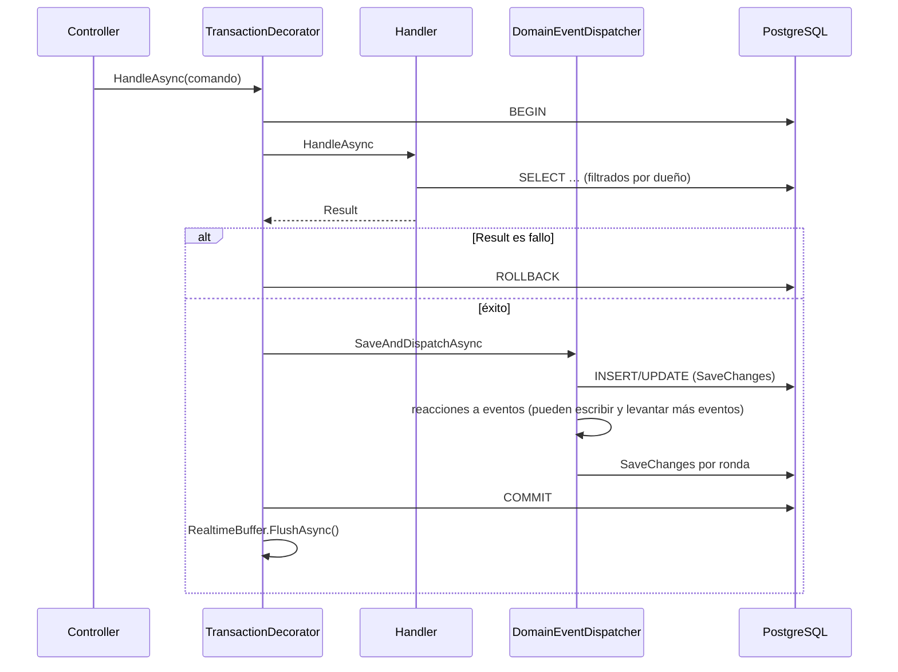
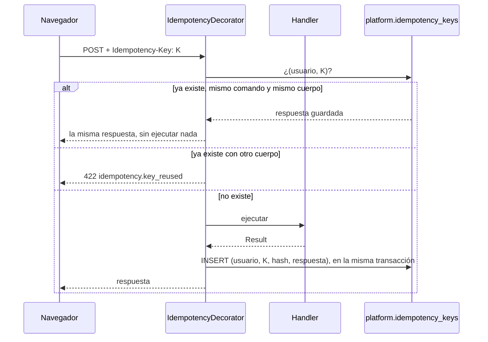

# Concurrencia, consistencia e idempotencia

Qué protege hoy el sistema cuando dos cosas pasan a la vez, qué no protege, y cómo escribir código que no rompa esas garantías. Es el documento a leer antes de tocar dinero, colas o jobs. Las rutas son relativas a `finanzas-hub-api/src/`.

## Resumen

| Riesgo | Protección | Dónde |
|---|---|---|
| Un comando deja la base a medias | Una transacción por comando, con sus reacciones dentro | `TransactionCommandHandlerDecorator` |
| Dos escrituras simultáneas sobre la misma fila | Concurrencia optimista con `xmin` → 409 `concurrency_conflict` | Configuraciones EF, decorador |
| Doble clic o reintento de red duplica un gasto | `Idempotency-Key` + `IIdempotentCommand` | `IdempotencyCommandHandlerDecorator` |
| Dos peticiones con la misma clave a la vez | PK `(user_id, key)` → 409 `idempotency.in_progress` | `IdempotencyRace` |
| Duplicados de negocio (dos presupuestos para una categoría…) | Índices únicos, a veces parciales | Migraciones ([database.md](database.md)) |
| Dos Workers envían el mismo correo | `FOR UPDATE SKIP LOCKED` | `Email.cs`, `WhatsApp.cs` |
| Un aviso repetido | Índice único `(user_id, dedupe_key)` en `notifications` | Notifications |
| Un webhook recibido dos veces | Índice único `(provider, external_id)` | `received_webhook_events` |
| El navegador recibe un cambio que luego se revirtió | Tiempo real solo después del commit | `RealtimeBuffer` |
| **Edición perdida entre dos pestañas** | **Ninguna todavía**: gana la última escritura | `ETag`/`If-Match` pendiente (§2) |

## 1. Una transacción por comando



Código: `Infrastructure/Messaging/HandlerDecorators.cs:89`. Reglas que se derivan:

- **El handler no llama a `SaveChanges`.** Si lo hiciera, las reacciones no verían sus eventos; `AppDbContext.EnsureDomainEventsWereDispatched` lo detecta y lanza.
- **Un `Result` de fallo revierte todo**, incluido lo que el handler ya hubiera añadido al contexto.
- **Una excepción en una reacción revierte el comando.** La reacción forma parte de la misma unidad de trabajo.
- **Un comando llamado desde dentro de otro se une a su transacción** (si `CurrentTransaction` no es nulo, el decorador no abre otra).
- Tras un rollback se llama a `ChangeTracker.Clear()`: las entidades cargadas ya no coinciden con la base y nada en ese scope debe reutilizarlas.
- El aislamiento es el de PostgreSQL por defecto, **Read Committed**: dos transacciones pueden leer el mismo dato antes de que ninguna escriba. Lo que deba ser único lo garantiza un índice único, no un `AnyAsync` previo (ver §4).

## 2. Concurrencia optimista con `xmin`

PostgreSQL cambia la columna de sistema `xmin` de una fila cada vez que se actualiza. Diez agregados la usan como token de concurrencia: `Workspace`, `Account`, `Operation`, `Budget`, `RecurringRule`, `Goal`, `SharedGroup`, `CategorizationRule`, `ImportSession` y `Holding` (las tablas con columna `xmin` en [database.md](database.md)). Los gastos y liquidaciones de un grupo viven dentro del agregado `SharedGroup`. EF añade `WHERE xmin = <valor leído>` a cada `UPDATE`; si no afecta a ninguna fila, lanza `DbUpdateConcurrencyException`, y el decorador responde:

```json
409 { "code": "concurrency_conflict", "detail": "The resource was changed by someone else. Reload it and try again." }
```

**Qué cubre:** dos peticiones que leen y escriben la misma fila *a la vez* (por ejemplo, dos participantes aportando a la misma meta en el mismo instante).

**Qué no cubre:** que una persona abra un formulario, otra cambie el recurso y la primera guarde un minuto después. Su petición lee el `xmin` *nuevo*, así que sobrescribe sin conflicto. Para eso hace falta `ETag` en la respuesta e `If-Match` en la escritura, que están diseñados ([ADR-016](../adr/ADR-016-idempotencia-y-concurrencia.md)) pero **no implementados** ([roadmap/status.md](../roadmap/status.md)). Con datos casi siempre privados y unos 10 usuarios, el riesgo es bajo; en metas y gastos compartidos es donde primero se notaría.

Para añadir el token a un agregado nuevo, en su configuración EF, igual que los existentes (por ejemplo `Infrastructure/Persistence/Configurations/Budgets/BudgetsConfigurations.cs:21`):

```csharp
builder.Property<uint>("Version").IsRowVersion();   // Npgsql lo mapea a la columna de sistema xmin
```

## 3. Idempotencia



- Lo usa todo comando con efecto financiero: implementa `IIdempotentCommand` y el controller lee la cabecera con `TryReadIdempotencyKey` (sin clave → 400 `idempotency.key_required`).
- El frontend crea la clave **al abrir el formulario**, no al enviar: un doble clic o un reintento repite la misma clave (`IDEMPOTENCY_KEY` en `finanzas-hub-web/src/app/core/http/api-interceptors.ts`).
- Las claves se guardan 7 días; las purga `PurgeExpiredIdempotencyKeysJob`.
- **Carrera:** si dos peticiones con la misma clave llegan a la vez, ninguna ve la fila de la otra. Las dos ejecutan, pero la segunda en hacer commit choca con la PK `pk_idempotency_keys`; el decorador lo reconoce (`IdempotencyRace.IsDuplicateKey`), revierte **todo** lo que esa petición hizo y responde 409 `idempotency.in_progress`. Al reintentar recibe la respuesta de la primera.

## 4. Índices únicos: la última barrera

Comprobar «¿ya existe?» con `AnyAsync` y luego insertar **no es seguro** con Read Committed: dos peticiones pueden pasar la comprobación a la vez. El `AnyAsync` sirve para dar un error amable; la garantía la da un índice único. Algunos del sistema:

| Regla | Índice |
|---|---|
| Un presupuesto por categoría y mes de inicio | `ix_budgets_owner_category_effective_from` |
| Una importación no crea dos veces la misma operación | `ix_operations_source_module_source_type_source_id` (parcial) |
| Un solo workspace personal por persona | `ix_workspaces_one_personal_per_owner` (parcial) |
| Un aviso no se repite | `ix_notifications_user_id_dedupe_key` (parcial) |
| Un aporte por operación del ledger | `ix_goal_contributions_ledger_operation_id` |
| Una ocurrencia por regla y fecha | PK de `scheduling.occurrences` `(rule_id, scheduled_on)` |
| Un evento de WhatsApp se procesa una vez | `ix_received_webhook_events_provider_external_id` |

Si violas uno, EF lanza `DbUpdateException` y la petición acaba en 500. Cuando la carrera sea plausible en uso normal, captura la violación (como hace `IdempotencyRace`) y devuelve un `Error.Conflict` con código propio.

## 5. Colas sin envíos dobles

El Worker reclama trabajo con `FOR UPDATE SKIP LOCKED` (`Infrastructure/Email/Email.cs:80`, `Infrastructure/WhatsApp/WhatsApp.cs:184`):

```sql
SELECT * FROM platform.outgoing_emails
WHERE sent_at IS NULL AND next_attempt_at <= @now AND attempts < @max
ORDER BY created_at
LIMIT @batch
FOR UPDATE SKIP LOCKED
```

Las filas quedan bloqueadas hasta el commit, y otro Worker se las salta en vez de esperar o repetirlas. La entrega es **al menos una vez**: si el SMTP acepta el correo y el commit falla después, se reenviará. Por eso los mensajes no deben depender de enviarse exactamente una vez, y los avisos usan una `dedupe_key`.

## 6. Jobs

- **Una sola instancia del Worker.** El envío tolera varias (§5), pero `RunDueOccurrencesJob` no está pensado para ejecutarse en paralelo consigo mismo: la PK de `occurrences` evita duplicados, pero la segunda ejecución fallaría y lo registraría como error.
- **Cada persona en su propio scope y su propia transacción**: un fallo con una no detiene a las demás (`Worker/Jobs/Scheduling/RunDueOccurrencesJob.cs`).
- **Reintento al minuto** tras un fallo (`PeriodicJob`): el job debe poder ejecutarse dos veces seguidas sin efecto doble. Diseña los jobs como «procesa lo pendiente», nunca como «haz X porque son las 9:00».
- El job actúa como la persona (`ActAs`), así que los filtros de privacidad se aplican igual que en una petición.

## 7. Tiempo real después del commit

`IRealtimeNotifier.ToUser(...)` no envía nada en el momento: lo acumula `RealtimeBuffer` (`Infrastructure/Messaging/Realtime.cs:21`), que se vacía después del commit (`FlushAsync`) o se descarta en un rollback (`Discard`). Así el navegador nunca recarga por un cambio que no llegó a existir. El mensaje solo dice «esto cambió»; el cliente pide el estado por HTTP, donde se aplica la autorización.

## 8. Cómo escribir código seguro

1. **Lee y escribe en el mismo comando.** No calcules en el frontend un valor que el backend acepte sin recalcular (saldos, totales, repartos).
2. **No guardes derivados.** El saldo se suma de los asientos; el gasto de un presupuesto se lee del ledger. Un dato derivado guardado es un dato que se desincroniza.
3. **Garantiza la unicidad con un índice**, no con una consulta previa.
4. **Haz idempotente todo lo que mueva dinero o se reintente**: comandos financieros, jobs y webhooks.
5. **Nada externo dentro de la transacción**: correo, WhatsApp y HTTP se encolan.
6. **Agregados pequeños.** Cuanto más grande es la fila que todos actualizan, más conflictos `xmin`.
7. **No captures `DbUpdateConcurrencyException` en el handler**: ya la traduce el decorador.

## 9. Probar una carrera

Los tests de integración usan PostgreSQL real, así que las carreras se pueden reproducir: lanza dos peticiones a la vez con `Task.WhenAll` sobre el cliente de la `WebApplicationFactory`. Esquema (adapta los nombres a los helpers de `tests/PersonalFinance.IntegrationTests/Support/`, por ejemplo `Books.cs`, que ya envía `Idempotency-Key`):

```csharp
var key = Guid.NewGuid().ToString();
var responses = await Task.WhenAll(PostExpense(key), PostExpense(key));

// Una crea; la otra devuelve la misma respuesta o 409 idempotency.in_progress.
// Después, en la base: exactamente una operación con ese importe.
```

Hoy no hay tests de carreras en la suite: si tocas el pipeline de comandos o una regla de unicidad, añade uno. Comprueba siempre el estado final en la base, no solo los códigos HTTP.

## Para estudiar

PostgreSQL MVCC y niveles de aislamiento, `SELECT … FOR UPDATE SKIP LOCKED`, concurrencia optimista en EF Core, idempotencia en APIs HTTP y entrega «al menos una vez». Enlaces en [study-guide.md](study-guide.md).
