# Base de datos

Referencia de la base de datos tal como existe hoy: convenciones, esquemas, tablas, relaciones, índices y restricciones. Para el razonamiento de diseño (por qué el ledger es de doble entrada, qué es privado y qué colaborativo) ver [data-model.md](data-model.md) y [ledger.md](ledger.md). El ERD de [diagrams/erd.md](../diagrams/erd.md) es el de diseño; **este documento es el que manda** cuando no coinciden, porque sale de las migraciones.

## Motor y acceso

| Qué | Valor |
|---|---|
| Motor | PostgreSQL 17 (en local sirve 17 o superior) |
| Base | `personal_hub` con `docker compose`; el nombre lo da la cadena de conexión |
| Acceso | Solo a través de EF Core 10 + Npgsql, con un único `AppDbContext` (`PersonalFinance.Infrastructure/Persistence`) |
| Mapeos | `Persistence/Configurations/<Módulo>/`, con la Fluent API. El dominio no lleva atributos de EF |
| Migraciones | `Persistence/Migrations/`. Historial en `platform.__ef_migrations_history` |
| Cadena de conexión | `ConnectionStrings:PersonalFinance` (ver [secrets.md](../devops/secrets.md)) |

Ningún módulo abre conexiones ni escribe SQL a mano: cada uno ve sus tablas mediante su interfaz `IXDb` (`ILedgerDb`, `IBudgetsDb`…), que implementa `AppDbContext`.

## Convenciones

| Tema | Regla |
|---|---|
| Esquemas | Uno por módulo (`ledger`, `budgets`…) más `platform` para lo transversal (auditoría, idempotencia, correos, claves de Data Protection). `Reporting` no tiene tablas |
| Nombres | `snake_case` automático (`EFCore.NamingConventions`). PK `pk_<tabla>`, índice `ix_<tabla>_<columnas>`, FK `fk_<tabla>_<tabla_ref>_<columna>`, CHECK `ck_<tabla>_<regla>` |
| Identificadores | `uuid` v7 generado por la aplicación (`Entity.NewId()`): ordenado en el tiempo y sin ida y vuelta a la base. Las tablas de Identity y Data Protection usan sus propias claves |
| Dinero | `numeric` con precisión fija, siempre junto a una columna de moneda ISO 4217 (`character(3)`). Los asientos del ledger usan `numeric(19,4)`; los importes de los demás módulos, `numeric(18,2)`; tipos de cambio y unidades, `numeric(18,8)` o `numeric(28,8)`; tasas, `numeric(9,4)`. Nunca `float` ni `double` |
| Fechas | Instantes en `timestamp with time zone` (UTC). Fechas contables (`occurred_on`, meses de presupuesto) en `date`, en la zona del workspace |
| Enumeraciones | Texto (`character varying`) con una restricción `CHECK` que lista los valores válidos. Se lee en SQL y añadir un valor es una migración explícita |
| Concurrencia | Los agregados que se editan a la vez usan la columna de sistema `xmin` como token de concurrencia. Si dos escrituras chocan, el comando responde 409 `concurrency_conflict`. La API todavía no expone la versión como `ETag` / `If-Match` ([concurrency.md](concurrency.md)) |
| Borrado | Nada financiero se borra: se anula (`status = 'Voided'`, `voided_at`, `void_reason`) o se archiva. `ON DELETE CASCADE` solo existe dentro de un agregado (las líneas de una operación, los participantes de una meta) |
| Claves foráneas | Solo **dentro** de un esquema. Entre módulos se guarda el id sin FK (líneas punteadas en los diagramas), para que cada módulo controle sus tablas y sus migraciones |
| Saldo | No hay columna de saldo: se calcula sumando `ledger.entries` |

## Privacidad a nivel de fila

PostgreSQL no aplica RLS; el aislamiento lo hace EF con **filtros globales** en `AppDbContext`:

- Toda entidad privada implementa `IOwned` y tiene `workspace_id` y `owner_user_id`. El filtro solo deja ver las filas de **la persona actual en su workspace personal** ([ADR-021](../adr/ADR-021-finanzas-privadas-de-la-persona.md)). Por eso los índices de las tablas privadas empiezan casi siempre por `owner_user_id` o por `workspace_id, owner_user_id`.
- `goals.goals` y `shared_expenses.shared_groups` son colaborativos: el filtro exige ser participante (o miembro del grupo) activo.
- Un recurso ajeno no aparece en la consulta, así que la API responde 404.

Consecuencia práctica: una consulta SQL directa (psql, pgAdmin) **no** tiene esos filtros. Cualquier informe o script fuera de la aplicación debe filtrar por dueño a mano.

## Estrategia de índices

- **Lecturas por dueño y fecha**: listas y reportes filtran por `owner_user_id` (o `workspace_id, owner_user_id`) y ordenan por fecha; los índices compuestos siguen ese orden (p. ej. `ix_operations_workspace_id_owner_user_id_occurred_on_id`, que sirve la paginación por cursor).
- **Unicidad de negocio**: índices únicos, a veces parciales (`WHERE ...`), para reglas como «una sola importación por origen» (`source_module, source_type, source_id` cuando `source_id IS NOT NULL`) o «un presupuesto por categoría y mes de inicio» (`ix_budgets_owner_category_effective_from`). La unicidad del correo de una cuenta la comprueba ASP.NET Core Identity (`RequireUniqueEmail`), no un índice: `EmailIndex` no es único.
- **Colas**: las tablas que procesa el Worker tienen un índice parcial sobre lo pendiente (`ix_outgoing_emails_next_attempt_at` con `sent_at IS NULL`, `ix_deliveries_pending` con `status = 'Pending'`), para que el job lo encuentre sin recorrer la tabla.
- **Idempotencia**: `platform.idempotency_keys` tiene PK `(user_id, key)` y un índice por expiración para la purga diaria.

Antes de añadir un índice, comprueba con `EXPLAIN ANALYZE` que la consulta lo usa. Con unos 10 usuarios el volumen es pequeño: un índice de más cuesta escrituras y mantenimiento sin beneficio visible.

## Cambiar el esquema

1. Cambia la entidad y su configuración en `Persistence/Configurations/<Módulo>/`.
2. `tools/add-migration.ps1 -Name DescribeElCambio` (desde `finanzas-hub-api`).
3. Revisa el `.cs` generado: renombres que EF interpretó como borrar y crear, datos existentes que no cumplen un `CHECK` nuevo, columnas `NOT NULL` sin valor por defecto.
4. Aplica en limpio y sobre tu base anterior (`tools/migrate.ps1`).
5. `node tools/update-db-docs.mjs` para regenerar la parte generada de este documento.

Más en [migrations.md](migrations.md).

## Copias de seguridad

La base contiene datos financieros, los hashes de las contraseñas y las claves de Data Protection (`platform.data_protection_keys`). Una copia (`pg_dump`) es tan sensible como la base misma: cifrada, fuera del repositorio y con acceso restringido. Restaurar una copia con otras claves de Data Protection cierra todas las sesiones e invalida los enlaces de correo pendientes.

## Esquema actual

<!-- generated:start -->

> Generado por `finanzas-hub-api/tools/update-db-docs.mjs` desde `AppDbContextModelSnapshot.cs`. No editar a mano entre las marcas. Última migración: `20261015055047_AddInvestments`.

**47 tablas** en 12 esquemas, **55 índices** secundarios, **27 claves foráneas** y **51 restricciones CHECK**.

### Tablas por esquema

| Esquema | Tablas |
|---|---|
| `identity` | [`user_claims`](#identityuser_claims), [`user_logins`](#identityuser_logins), [`user_tokens`](#identityuser_tokens), [`users`](#identityusers), [`user_preferences`](#identityuser_preferences) |
| `workspaces` | [`invitations`](#workspacesinvitations), [`memberships`](#workspacesmemberships), [`workspaces`](#workspacesworkspaces) |
| `categories` | [`categories`](#categoriescategories), [`tags`](#categoriestags), [`category_tags`](#categoriescategory_tags) |
| `ledger` | [`accounts`](#ledgeraccounts), [`entries`](#ledgerentries), [`exchange_rates`](#ledgerexchange_rates), [`operations`](#ledgeroperations), [`credit_card_profiles`](#ledgercredit_card_profiles), [`operation_tags`](#ledgeroperation_tags) |
| `budgets` | [`budgets`](#budgetsbudgets) |
| `notifications` | [`channel_endpoints`](#notificationschannel_endpoints), [`deliveries`](#notificationsdeliveries), [`notifications`](#notificationsnotifications), [`notification_settings`](#notificationsnotification_settings), [`received_webhook_events`](#notificationsreceived_webhook_events), [`notification_preferences`](#notificationsnotification_preferences) |
| `scheduling` | [`recurring_rules`](#schedulingrecurring_rules), [`occurrences`](#schedulingoccurrences) |
| `goals` | [`goals`](#goalsgoals), [`goal_contributions`](#goalsgoal_contributions), [`goal_participants`](#goalsgoal_participants) |
| `shared_expenses` | [`shared_groups`](#shared_expensesshared_groups), [`group_members`](#shared_expensesgroup_members), [`settlements`](#shared_expensessettlements), [`settlement_allocations`](#shared_expensessettlement_allocations), [`shared_expenses`](#shared_expensesshared_expenses), [`expense_shares`](#shared_expensesexpense_shares) |
| `integrations` | [`categorization_rules`](#integrationscategorization_rules), [`import_records`](#integrationsimport_records), [`import_sessions`](#integrationsimport_sessions), [`import_accounts`](#integrationsimport_accounts), [`import_categories`](#integrationsimport_categories) |
| `investments` | [`holdings`](#investmentsholdings), [`holding_movements`](#investmentsholding_movements), [`holding_valuations`](#investmentsholding_valuations) |
| `platform` | [`data_protection_keys`](#platformdata_protection_keys), [`audit_log`](#platformaudit_log), [`idempotency_keys`](#platformidempotency_keys), [`outgoing_emails`](#platformoutgoing_emails) |

### Vista general

Relaciones entre tablas: línea continua, clave foránea; punteada, referencia por id entre módulos (sin FK). Para no saturar el diagrama se omiten las referencias a `identity.users` y `workspaces.workspaces`, que tienen casi todas las tablas.

```mermaid
erDiagram
    identity__users ||--o{ identity__user_claims : "user_id"
    identity__users ||--o{ identity__user_logins : "user_id"
    identity__users ||--o{ identity__user_tokens : "user_id"
    categories__categories ||..o{ budgets__budgets : "category_id"
    categories__categories |o--o{ categories__categories : "parent_id"
    identity__users ||--o| identity__user_preferences : "user_id"
    categories__categories ||..o{ integrations__categorization_rules : "category_id"
    integrations__import_sessions ||--o{ integrations__import_records : "session_id"
    categories__categories |o..o{ integrations__import_records : "category_id"
    ledger__operations |o..o{ integrations__import_records : "operation_id"
    ledger__accounts ||..o{ investments__holdings : "account_id"
    ledger__accounts ||--o{ ledger__entries : "account_id"
    ledger__operations ||--o{ ledger__entries : "operation_id"
    categories__categories |o..o{ ledger__operations : "category_id"
    notifications__notifications |o..o{ notifications__deliveries : "notification_id"
    ledger__accounts ||..o{ scheduling__recurring_rules : "account_id"
    categories__categories ||..o{ scheduling__recurring_rules : "category_id"
    workspaces__workspaces ||--o{ workspaces__invitations : "workspace_id"
    workspaces__workspaces ||--o{ workspaces__memberships : "workspace_id"
    categories__categories ||--o{ categories__category_tags : "category_id"
    categories__tags ||--o{ categories__category_tags : "tag_id"
    goals__goals ||--o{ goals__goal_contributions : "goal_id"
    ledger__operations ||..o{ goals__goal_contributions : "ledger_operation_id"
    goals__goals ||--o{ goals__goal_participants : "goal_id"
    ledger__accounts |o..o{ goals__goal_participants : "fund_account_id"
    integrations__import_sessions ||--o{ integrations__import_accounts : "session_id"
    ledger__accounts |o..o{ integrations__import_accounts : "account_id"
    integrations__import_sessions ||--o{ integrations__import_categories : "session_id"
    categories__categories |o..o{ integrations__import_categories : "category_id"
    investments__holdings ||--o{ investments__holding_movements : "holding_id"
    ledger__accounts ||..o{ investments__holding_movements : "cash_account_id"
    investments__holdings ||--o{ investments__holding_valuations : "holding_id"
    ledger__accounts ||--o| ledger__credit_card_profiles : "account_id"
    ledger__operations ||--o{ ledger__operation_tags : "operation_id"
    categories__tags ||..o{ ledger__operation_tags : "tag_id"
    notifications__notification_settings ||--o{ notifications__notification_preferences : "user_id"
    scheduling__recurring_rules ||--o{ scheduling__occurrences : "rule_id"
    ledger__operations |o..o{ scheduling__occurrences : "operation_id"
    shared_expenses__shared_groups ||--o{ shared_expenses__group_members : "group_id"
    shared_expenses__shared_groups ||--o{ shared_expenses__settlements : "group_id"
    ledger__operations |o..o{ shared_expenses__settlements : "from_operation_id"
    ledger__operations |o..o{ shared_expenses__settlements : "to_operation_id"
    shared_expenses__settlements ||--o{ shared_expenses__settlement_allocations : "settlement_id"
    shared_expenses__shared_expenses ||..o{ shared_expenses__settlement_allocations : "expense_id"
    shared_expenses__shared_groups ||--o{ shared_expenses__shared_expenses : "group_id"
    categories__categories |o..o{ shared_expenses__shared_expenses : "payer_category_id"
    ledger__operations |o..o{ shared_expenses__shared_expenses : "payer_operation_id"
    shared_expenses__shared_expenses ||--o{ shared_expenses__expense_shares : "expense_id"
    platform__data_protection_keys
    platform__audit_log
    platform__idempotency_keys
    platform__outgoing_emails
    ledger__exchange_rates
    notifications__channel_endpoints
    notifications__received_webhook_events
```

### Detalle por esquema

### Esquema `identity`

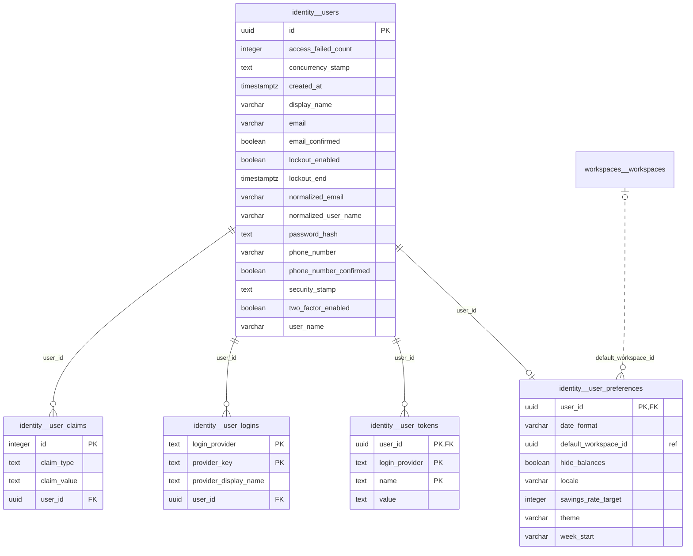

#### `identity.user_claims`

Claims de ASP.NET Core Identity. Sin uso propio hoy.

| Columna | Tipo | Nulo | Notas |
|---|---|---|---|
| `id` | integer | no | PK |
| `claim_type` | text | sí |  |
| `claim_value` | text | sí |  |
| `user_id` | uuid | no | FK → `identity.users` |

Índices (además de la PK `pk_user_claims`):

| Nombre | Columnas | Único | Filtro |
|---|---|---|---|
| `ix_user_claims_user_id` | `user_id` | no |  |

| Clave foránea | Columnas | Referencia | ON DELETE |
|---|---|---|---|
| `fk_user_claims_asp_net_users_user_id` | `user_id` | `identity.users` | CASCADE |

#### `identity.user_logins`

Inicios de sesión externos de ASP.NET Core Identity. Sin uso propio hoy.

| Columna | Tipo | Nulo | Notas |
|---|---|---|---|
| `login_provider` | text | sí | PK |
| `provider_key` | text | sí | PK |
| `provider_display_name` | text | sí |  |
| `user_id` | uuid | no | FK → `identity.users` |

Índices (además de la PK `pk_user_logins`):

| Nombre | Columnas | Único | Filtro |
|---|---|---|---|
| `ix_user_logins_user_id` | `user_id` | no |  |

| Clave foránea | Columnas | Referencia | ON DELETE |
|---|---|---|---|
| `fk_user_logins_users_user_id` | `user_id` | `identity.users` | CASCADE |

#### `identity.user_tokens`

Tokens de ASP.NET Core Identity.

| Columna | Tipo | Nulo | Notas |
|---|---|---|---|
| `user_id` | uuid | no | PK; FK → `identity.users` |
| `login_provider` | text | sí | PK |
| `name` | text | sí | PK |
| `value` | text | sí |  |

| Clave foránea | Columnas | Referencia | ON DELETE |
|---|---|---|---|
| `fk_user_tokens_users_user_id` | `user_id` | `identity.users` | CASCADE |

#### `identity.users`

A person who can sign in. Credentials, lockout and tokens are ASP.NET Core Identity's; this type only adds what the application itself needs to know about the person. The email is also the user name.

| Columna | Tipo | Nulo | Notas |
|---|---|---|---|
| `id` | uuid | no | PK |
| `access_failed_count` | integer | no |  |
| `concurrency_stamp` | text | sí | concurrencia optimista |
| `created_at` | timestamp with time zone | no |  |
| `display_name` | character varying(80) | no |  |
| `email` | character varying(256) | sí |  |
| `email_confirmed` | boolean | no |  |
| `lockout_enabled` | boolean | no |  |
| `lockout_end` | timestamp with time zone | sí |  |
| `normalized_email` | character varying(256) | sí |  |
| `normalized_user_name` | character varying(256) | sí |  |
| `password_hash` | text | sí |  |
| `phone_number` | character varying(20) | sí |  |
| `phone_number_confirmed` | boolean | no |  |
| `security_stamp` | text | sí |  |
| `two_factor_enabled` | boolean | no |  |
| `user_name` | character varying(256) | sí |  |

Índices (además de la PK `pk_users`):

| Nombre | Columnas | Único | Filtro |
|---|---|---|---|
| `EmailIndex` | `normalized_email` | no |  |
| `UserNameIndex` | `normalized_user_name` | sí |  |

#### `identity.user_preferences`

How one person wants the application to look and behave. One row per user.

| Columna | Tipo | Nulo | Notas |
|---|---|---|---|
| `user_id` | uuid | no | PK; FK → `identity.users` |
| `date_format` | character varying(20) | no |  |
| `default_workspace_id` | uuid | sí | ref. → `workspaces.workspaces` (sin FK) |
| `hide_balances` | boolean | no |  |
| `locale` | character varying(10) | no |  |
| `savings_rate_target` | integer | sí |  |
| `theme` | character varying(10) | no |  |
| `week_start` | character varying(10) | no |  |

| Clave foránea | Columnas | Referencia | ON DELETE |
|---|---|---|---|
| `fk_user_preferences_users_user_id` | `user_id` | `identity.users` | CASCADE |

| Restricción CHECK | Condición |
|---|---|
| `ck_user_preferences_savings_rate_target` | `savings_rate_target BETWEEN 0 AND 100` |
| `ck_user_preferences_theme` | `theme IN ('Dark', 'Light')` |
| `ck_user_preferences_week_start` | `week_start IN ('Monday', 'Sunday')` |

### Esquema `workspaces`

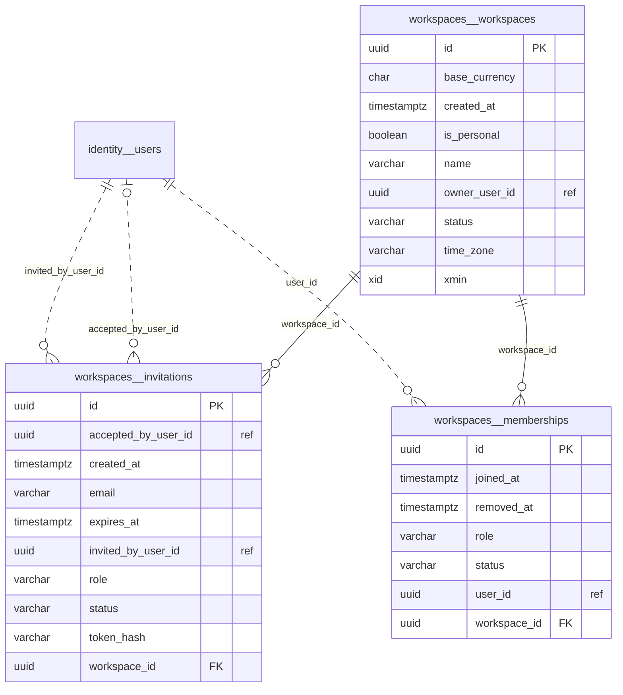

#### `workspaces.invitations`

An offer to join a workspace, sent to an email address that may not have an account yet. Only the hash of its token is stored: the token itself exists in the link that was emailed and nowhere else.

| Columna | Tipo | Nulo | Notas |
|---|---|---|---|
| `id` | uuid | no | PK |
| `accepted_by_user_id` | uuid | sí | ref. → `identity.users` (sin FK) |
| `created_at` | timestamp with time zone | no |  |
| `email` | character varying(254) | no |  |
| `expires_at` | timestamp with time zone | no |  |
| `invited_by_user_id` | uuid | no | ref. → `identity.users` (sin FK) |
| `role` | character varying(16) | no |  |
| `status` | character varying(16) | no |  |
| `token_hash` | character varying(64) | no |  |
| `workspace_id` | uuid | no | FK → `workspaces.workspaces` |

Índices (además de la PK `pk_invitations`):

| Nombre | Columnas | Único | Filtro |
|---|---|---|---|
| `ix_invitations_token_hash` | `token_hash` | sí |  |
| `ix_invitations_workspace_id_status` | `workspace_id`, `status` | no |  |

| Clave foránea | Columnas | Referencia | ON DELETE |
|---|---|---|---|
| `fk_invitations_workspaces_workspace_id` | `workspace_id` | `workspaces.workspaces` | CASCADE |

| Restricción CHECK | Condición |
|---|---|
| `ck_invitations_role` | `role IN ('Member', 'Admin')` |
| `ck_invitations_status` | `status IN ('Pending', 'Accepted', 'Revoked')` |

#### `workspaces.memberships`

One person in one workspace. Removing a member keeps the row, so history stays attributable.

| Columna | Tipo | Nulo | Notas |
|---|---|---|---|
| `id` | uuid | no | PK |
| `joined_at` | timestamp with time zone | no |  |
| `removed_at` | timestamp with time zone | sí |  |
| `role` | character varying(16) | no |  |
| `status` | character varying(16) | no |  |
| `user_id` | uuid | no | ref. → `identity.users` (sin FK) |
| `workspace_id` | uuid | no | FK → `workspaces.workspaces` |

Índices (además de la PK `pk_memberships`):

| Nombre | Columnas | Único | Filtro |
|---|---|---|---|
| `ix_memberships_user_id` | `user_id` | no | `status = 'Active'` |
| `ix_memberships_workspace_id_user_id` | `workspace_id`, `user_id` | sí |  |

| Clave foránea | Columnas | Referencia | ON DELETE |
|---|---|---|---|
| `fk_memberships_workspaces_workspace_id` | `workspace_id` | `workspaces.workspaces` | CASCADE |

| Restricción CHECK | Condición |
|---|---|
| `ck_memberships_role` | `role IN ('Member', 'Admin', 'Owner')` |
| `ck_memberships_status` | `status IN ('Active', 'Removed')` |

#### `workspaces.workspaces`

A directory of people and the container of what they share. Belonging to it gives no access to another member's finances: roles only govern who administers the workspace itself.

| Columna | Tipo | Nulo | Notas |
|---|---|---|---|
| `id` | uuid | no | PK |
| `base_currency` | char(3) | sí |  |
| `created_at` | timestamp with time zone | no |  |
| `is_personal` | boolean | no |  |
| `name` | character varying(80) | no |  |
| `owner_user_id` | uuid | no | ref. → `identity.users` (sin FK) |
| `status` | character varying(16) | no |  |
| `time_zone` | character varying(64) | no |  |
| `xmin` | xid | no | concurrencia optimista |

Índices (además de la PK `pk_workspaces`):

| Nombre | Columnas | Único | Filtro |
|---|---|---|---|
| `ix_workspaces_one_personal_per_owner` | `owner_user_id` | sí | `is_personal` |

| Restricción CHECK | Condición |
|---|---|
| `ck_workspaces_base_currency` | `status <> 'Active' OR base_currency IS NOT NULL` |
| `ck_workspaces_status` | `status IN ('PendingSetup', 'Active', 'Archived')` |

### Esquema `categories`

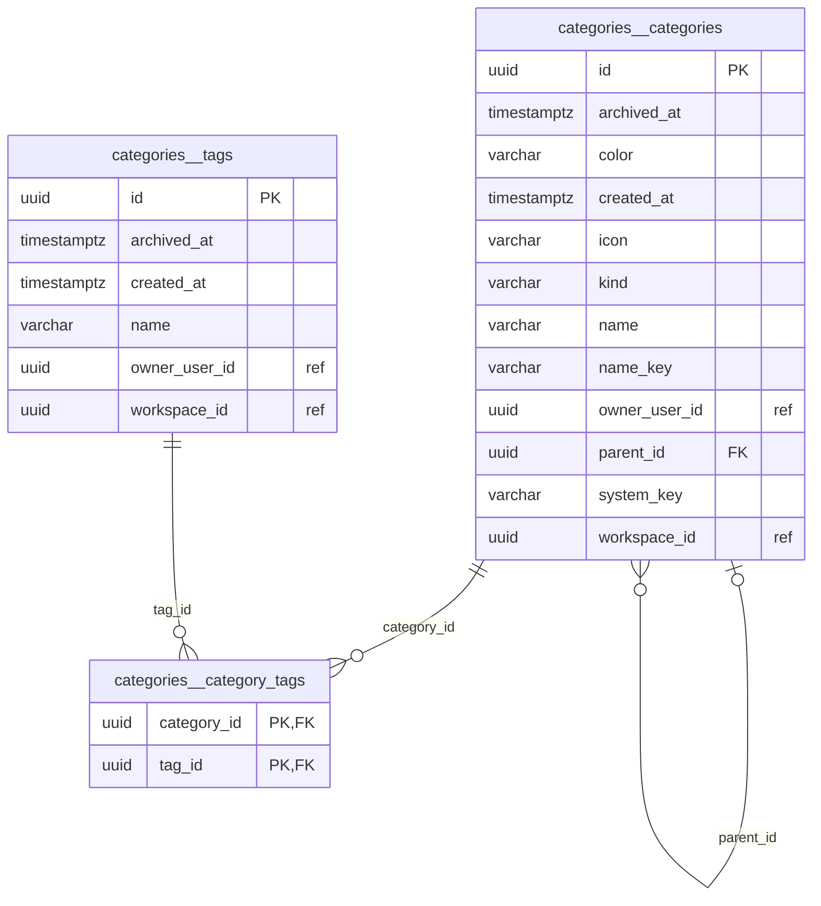

#### `categories.categories`

A way to classify income or expenses. It belongs to one person: two members of a workspace each have their own. There are two levels: a category and its subcategories. A subcategory takes its kind, icon, colour and suggested tags from its parent, so it stores none of them.

| Columna | Tipo | Nulo | Notas |
|---|---|---|---|
| `id` | uuid | no | PK |
| `archived_at` | timestamp with time zone | sí |  |
| `color` | character varying(16) | sí |  |
| `created_at` | timestamp with time zone | no |  |
| `icon` | character varying(40) | sí |  |
| `kind` | character varying(16) | no |  |
| `name` | character varying(60) | no |  |
| `name_key` | character varying(60) | no |  |
| `owner_user_id` | uuid | no | ref. → `identity.users` (sin FK) |
| `parent_id` | uuid | sí | FK → `categories.categories` |
| `system_key` | character varying(80) | sí |  |
| `workspace_id` | uuid | no | ref. → `workspaces.workspaces` (sin FK) |

Índices (además de la PK `pk_categories`):

| Nombre | Columnas | Único | Filtro |
|---|---|---|---|
| `ix_categories_parent_id` | `parent_id` | no |  |
| `ix_categories_workspace_id_owner_user_id_system_key` | `workspace_id`, `owner_user_id`, `system_key` | sí | `system_key IS NOT NULL` |
| `ix_categories_workspace_id_owner_user_id_parent_id_name_key` | `workspace_id`, `owner_user_id`, `parent_id`, `name_key` | sí | `archived_at IS NULL` |

| Clave foránea | Columnas | Referencia | ON DELETE |
|---|---|---|---|
| `fk_categories_categories_parent_id` | `parent_id` | `categories.categories` | RESTRICT |

| Restricción CHECK | Condición |
|---|---|
| `ck_categories_color` | `color IN ('Green', 'Blue', 'Violet', 'Amber', 'Red')` |
| `ck_categories_kind` | `kind IN ('Income', 'Expense')` |
| `ck_categories_look` | `(parent_id IS NULL) = (icon IS NOT NULL) AND (parent_id IS NULL) = (color IS NOT NULL)` |

#### `categories.tags`

A free label, private to one person. A category suggests some; from the ledger on, a transaction carries its own. The name is its identity for the person, so it is stored normalized.

| Columna | Tipo | Nulo | Notas |
|---|---|---|---|
| `id` | uuid | no | PK |
| `archived_at` | timestamp with time zone | sí |  |
| `created_at` | timestamp with time zone | no |  |
| `name` | character varying(40) | no |  |
| `owner_user_id` | uuid | no | ref. → `identity.users` (sin FK) |
| `workspace_id` | uuid | no | ref. → `workspaces.workspaces` (sin FK) |

Índices (además de la PK `pk_tags`):

| Nombre | Columnas | Único | Filtro |
|---|---|---|---|
| `ix_tags_workspace_id_owner_user_id_name` | `workspace_id`, `owner_user_id`, `name` | sí |  |

#### `categories.category_tags`

One suggested tag of a category.

| Columna | Tipo | Nulo | Notas |
|---|---|---|---|
| `category_id` | uuid | no | PK; FK → `categories.categories` |
| `tag_id` | uuid | no | PK; FK → `categories.tags` |

Índices (además de la PK `pk_category_tags`):

| Nombre | Columnas | Único | Filtro |
|---|---|---|---|
| `ix_category_tags_tag_id` | `tag_id` | no |  |

| Clave foránea | Columnas | Referencia | ON DELETE |
|---|---|---|---|
| `fk_category_tags_categories_category_id` | `category_id` | `categories.categories` | CASCADE |
| `fk_category_tags_tags_tag_id` | `tag_id` | `categories.tags` | RESTRICT |

### Esquema `ledger`

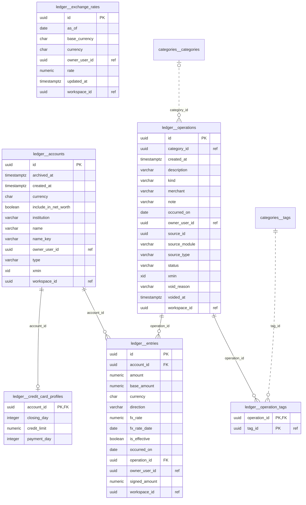

#### `ledger.accounts`

A place that holds money of one person, in one currency. It has no balance of its own: the balance is the sum of its entries, so there is nothing here that could disagree with the ledger.

| Columna | Tipo | Nulo | Notas |
|---|---|---|---|
| `id` | uuid | no | PK |
| `archived_at` | timestamp with time zone | sí |  |
| `created_at` | timestamp with time zone | no |  |
| `currency` | char(3) | no |  |
| `include_in_net_worth` | boolean | no |  |
| `institution` | character varying(60) | sí |  |
| `name` | character varying(60) | no |  |
| `name_key` | character varying(60) | no |  |
| `owner_user_id` | uuid | no | ref. → `identity.users` (sin FK) |
| `type` | character varying(16) | no |  |
| `xmin` | xid | no | concurrencia optimista |
| `workspace_id` | uuid | no | ref. → `workspaces.workspaces` (sin FK) |

Índices (además de la PK `pk_accounts`):

| Nombre | Columnas | Único | Filtro |
|---|---|---|---|
| `ix_accounts_workspace_id_owner_user_id_name_key` | `workspace_id`, `owner_user_id`, `name_key` | sí | `archived_at IS NULL` |

| Restricción CHECK | Condición |
|---|---|
| `ck_accounts_type` | `type IN ('Bank', 'Cash', 'Wallet', 'CreditCard', 'GoalFund', 'Investment')` |

#### `ledger.entries`

One movement on one account, in that account's currency. The amount is positive and the direction explicit. It repeats the owner, the date and whether it counts from its operation, so a balance is one indexed sum over this table alone, filtered by owner like everything private.

| Columna | Tipo | Nulo | Notas |
|---|---|---|---|
| `id` | uuid | no | PK |
| `account_id` | uuid | no | FK → `ledger.accounts` |
| `amount` | numeric(19,4) | no |  |
| `base_amount` | numeric(19,4) | sí |  |
| `currency` | char(3) | no |  |
| `direction` | character varying(4) | no |  |
| `fx_rate` | numeric(18,8) | sí |  |
| `fx_rate_date` | date | sí |  |
| `is_effective` | boolean | no |  |
| `occurred_on` | date | no |  |
| `operation_id` | uuid | no | FK → `ledger.operations` |
| `owner_user_id` | uuid | no | ref. → `identity.users` (sin FK) |
| `signed_amount` | numeric(19,4) | no | calculada: `CASE WHEN direction = 'In' THEN amount ELSE -amount END` |
| `workspace_id` | uuid | no | ref. → `workspaces.workspaces` (sin FK) |

Índices (además de la PK `pk_entries`):

| Nombre | Columnas | Único | Filtro |
|---|---|---|---|
| `ix_entries_operation_id` | `operation_id` | no |  |
| `ix_entries_account_id_occurred_on` | `account_id`, `occurred_on` | no | `is_effective` |

| Clave foránea | Columnas | Referencia | ON DELETE |
|---|---|---|---|
| `fk_entries_accounts_account_id` | `account_id` | `ledger.accounts` | RESTRICT |
| `fk_entries_operations_operation_id` | `operation_id` | `ledger.operations` | CASCADE |

| Restricción CHECK | Condición |
|---|---|
| `ck_entries_amount` | `amount > 0` |
| `ck_entries_direction` | `direction IN ('In', 'Out')` |

#### `ledger.exchange_rates`

A reference rate a person keeps by hand: how much of the base currency one unit of another currency is worth from a given day. It values balances and reports; it never moves money.

| Columna | Tipo | Nulo | Notas |
|---|---|---|---|
| `id` | uuid | no | PK |
| `as_of` | date | no |  |
| `base_currency` | char(3) | no |  |
| `currency` | char(3) | no |  |
| `owner_user_id` | uuid | no | ref. → `identity.users` (sin FK) |
| `rate` | numeric(18,8) | no |  |
| `updated_at` | timestamp with time zone | no |  |
| `workspace_id` | uuid | no | ref. → `workspaces.workspaces` (sin FK) |

Índices (además de la PK `pk_exchange_rates`):

| Nombre | Columnas | Único | Filtro |
|---|---|---|---|
| `ix_exchange_rates_owner_currency_as_of` | `workspace_id`, `owner_user_id`, `base_currency`, `currency`, `as_of` | sí |  |

| Restricción CHECK | Condición |
|---|---|
| `ck_exchange_rates_rate` | `rate > 0 AND currency <> base_currency` |

#### `ledger.operations`

The business fact a person sees as "a transaction". Its entries are what moves the balance of an account. It is never deleted: voiding it takes it out of every sum and keeps it for the record.

| Columna | Tipo | Nulo | Notas |
|---|---|---|---|
| `id` | uuid | no | PK |
| `category_id` | uuid | sí | ref. → `categories.categories` (sin FK) |
| `created_at` | timestamp with time zone | no |  |
| `description` | character varying(120) | no |  |
| `kind` | character varying(16) | no |  |
| `merchant` | character varying(80) | sí |  |
| `note` | character varying(500) | sí |  |
| `occurred_on` | date | no |  |
| `owner_user_id` | uuid | no | ref. → `identity.users` (sin FK) |
| `source_id` | uuid | sí |  |
| `source_module` | character varying(40) | sí |  |
| `source_type` | character varying(40) | sí |  |
| `status` | character varying(16) | no |  |
| `xmin` | xid | no | concurrencia optimista |
| `void_reason` | character varying(200) | sí |  |
| `voided_at` | timestamp with time zone | sí |  |
| `workspace_id` | uuid | no | ref. → `workspaces.workspaces` (sin FK) |

Índices (además de la PK `pk_operations`):

| Nombre | Columnas | Único | Filtro |
|---|---|---|---|
| `ix_operations_owner_user_id_category_id_occurred_on` | `owner_user_id`, `category_id`, `occurred_on` | no |  |
| `ix_operations_source_module_source_type_source_id` | `source_module`, `source_type`, `source_id` | sí | `source_id IS NOT NULL` |
| `ix_operations_workspace_id_owner_user_id_occurred_on_id` | `workspace_id`, `owner_user_id`, `occurred_on`, `id` (con orden descendente) | no |  |

| Restricción CHECK | Condición |
|---|---|
| `ck_operations_category` | `kind NOT IN ('Income', 'Expense', 'Refund') OR category_id IS NOT NULL` |
| `ck_operations_kind` | `kind IN ('Income', 'Expense', 'Refund', 'Transfer', 'Adjustment', 'OpeningBalance')` |
| `ck_operations_status` | `status IN ('Pending', 'Confirmed', 'Voided')` |

#### `ledger.credit_card_profiles`

What makes an account a credit card: its line and the days of its cycle. What is owed is not here: it is the balance of the account, negative while there is debt, and what is left to spend is the line plus that balance.

| Columna | Tipo | Nulo | Notas |
|---|---|---|---|
| `account_id` | uuid | no | PK; FK → `ledger.accounts` |
| `closing_day` | integer | sí |  |
| `credit_limit` | numeric(19,4) | no |  |
| `payment_day` | integer | no |  |

| Clave foránea | Columnas | Referencia | ON DELETE |
|---|---|---|---|
| `fk_credit_card_profiles_accounts_id` | `account_id` | `ledger.accounts` | CASCADE |

| Restricción CHECK | Condición |
|---|---|
| `ck_credit_card_profiles_days` | `payment_day BETWEEN 1 AND 31 AND (closing_day IS NULL OR closing_day BETWEEN 1 AND 31)` |
| `ck_credit_card_profiles_limit` | `credit_limit > 0` |

#### `ledger.operation_tags`

One tag of an operation, by id: tags belong to the Categories module.

| Columna | Tipo | Nulo | Notas |
|---|---|---|---|
| `operation_id` | uuid | no | PK; FK → `ledger.operations` |
| `tag_id` | uuid | no | PK; ref. → `categories.tags` (sin FK) |

Índices (además de la PK `pk_operation_tags`):

| Nombre | Columnas | Único | Filtro |
|---|---|---|---|
| `ix_operation_tags_tag_id` | `tag_id` | no |  |

| Clave foránea | Columnas | Referencia | ON DELETE |
|---|---|---|---|
| `fk_operation_tags_operations_operation_id` | `operation_id` | `ledger.operations` | CASCADE |

### Esquema `budgets`

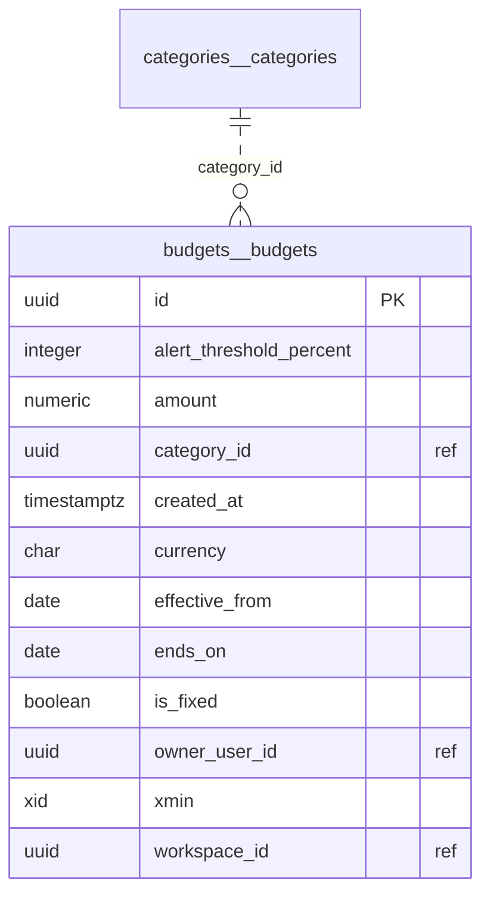

#### `budgets.budgets`

How much one person plans to spend in a category each month, from one month on. It is a plan, not a fact: what was spent is never stored here, it is read from the ledger. Changing the limit does not rewrite the months already gone: the budget is closed and a new one starts in the month of the change.

| Columna | Tipo | Nulo | Notas |
|---|---|---|---|
| `id` | uuid | no | PK |
| `alert_threshold_percent` | integer | no |  |
| `amount` | numeric(18,2) | no |  |
| `category_id` | uuid | no | ref. → `categories.categories` (sin FK) |
| `created_at` | timestamp with time zone | no |  |
| `currency` | character(3) | no |  |
| `effective_from` | date | no |  |
| `ends_on` | date | sí |  |
| `is_fixed` | boolean | no |  |
| `owner_user_id` | uuid | no | ref. → `identity.users` (sin FK) |
| `xmin` | xid | no | concurrencia optimista |
| `workspace_id` | uuid | no | ref. → `workspaces.workspaces` (sin FK) |

Índices (además de la PK `pk_budgets`):

| Nombre | Columnas | Único | Filtro |
|---|---|---|---|
| `ix_budgets_owner_category_effective_from` | `workspace_id`, `owner_user_id`, `category_id`, `effective_from` | sí |  |

| Restricción CHECK | Condición |
|---|---|
| `ck_budgets_alert_threshold` | `alert_threshold_percent IN (75, 90, 100)` |
| `ck_budgets_amount` | `amount > 0` |
| `ck_budgets_validity` | `ends_on IS NULL OR ends_on >= effective_from` |

### Esquema `notifications`

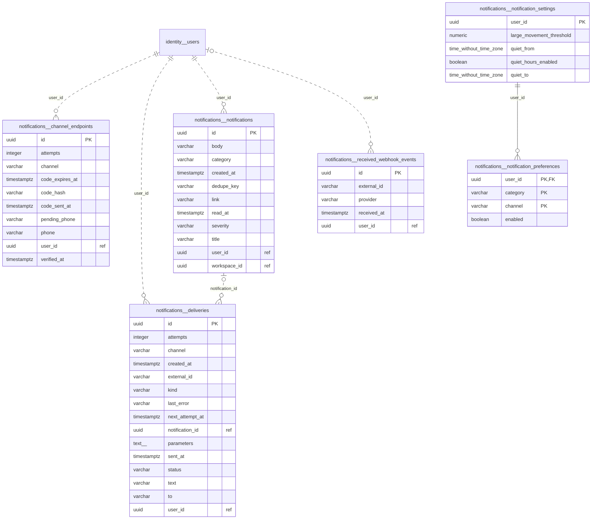

#### `notifications.channel_endpoints`

The WhatsApp number of a person. It counts only once they typed the code sent to it, which proves the number is theirs: only then do notices go to it and do messages from it speak for them. One per person.

| Columna | Tipo | Nulo | Notas |
|---|---|---|---|
| `id` | uuid | no | PK |
| `attempts` | integer | no |  |
| `channel` | character varying(16) | no |  |
| `code_expires_at` | timestamp with time zone | sí |  |
| `code_hash` | character varying(64) | sí |  |
| `code_sent_at` | timestamp with time zone | sí |  |
| `pending_phone` | character varying(15) | sí |  |
| `phone` | character varying(15) | sí |  |
| `user_id` | uuid | no | ref. → `identity.users` (sin FK) |
| `verified_at` | timestamp with time zone | sí |  |

Índices (además de la PK `pk_channel_endpoints`):

| Nombre | Columnas | Único | Filtro |
|---|---|---|---|
| `ix_channel_endpoints_channel_phone` | `channel`, `phone` | sí | `phone IS NOT NULL` |
| `ix_channel_endpoints_user_id_channel` | `user_id`, `channel` | sí |  |

#### `notifications.deliveries`

A message waiting to go out by WhatsApp, or that went. It is written in the transaction of what caused it and a Worker job sends it with retries; WhatsApp then tells how it went. What it said is cleared once sent.

| Columna | Tipo | Nulo | Notas |
|---|---|---|---|
| `id` | uuid | no | PK |
| `attempts` | integer | no |  |
| `channel` | character varying(16) | no |  |
| `created_at` | timestamp with time zone | no |  |
| `external_id` | character varying(200) | sí |  |
| `kind` | character varying(24) | no |  |
| `last_error` | character varying(500) | sí |  |
| `next_attempt_at` | timestamp with time zone | no |  |
| `notification_id` | uuid | sí | ref. → `notifications.notifications` (sin FK) |
| `parameters` | text[] | no |  |
| `sent_at` | timestamp with time zone | sí |  |
| `status` | character varying(16) | no |  |
| `text` | character varying(1000) | sí |  |
| `to` | character varying(15) | no |  |
| `user_id` | uuid | no | ref. → `identity.users` (sin FK) |

Índices (además de la PK `pk_deliveries`):

| Nombre | Columnas | Único | Filtro |
|---|---|---|---|
| `ix_deliveries_external_id` | `external_id` | no | `external_id IS NOT NULL` |
| `ix_deliveries_pending` | `next_attempt_at` | no | `status = 'Pending'` |
| `ix_deliveries_user_id` | `user_id` | no |  |

#### `notifications.notifications`

A notice in the inbox of a person. It belongs to the person, not to a workspace, and only they read it.

| Columna | Tipo | Nulo | Notas |
|---|---|---|---|
| `id` | uuid | no | PK |
| `body` | character varying(500) | no |  |
| `category` | character varying(32) | no |  |
| `created_at` | timestamp with time zone | no |  |
| `dedupe_key` | character varying(200) | sí |  |
| `link` | character varying(200) | sí |  |
| `read_at` | timestamp with time zone | sí |  |
| `severity` | character varying(16) | no |  |
| `title` | character varying(120) | no |  |
| `user_id` | uuid | no | ref. → `identity.users` (sin FK) |
| `workspace_id` | uuid | sí | ref. → `workspaces.workspaces` (sin FK) |

Índices (además de la PK `pk_notifications`):

| Nombre | Columnas | Único | Filtro |
|---|---|---|---|
| `ix_notifications_unread` | `user_id` | no | `read_at IS NULL` |
| `ix_notifications_user_id_created_at` | `user_id`, `created_at` | no |  |
| `ix_notifications_user_id_dedupe_key` | `user_id`, `dedupe_key` | sí | `dedupe_key IS NOT NULL` |

#### `notifications.notification_settings`

How one person wants to be told: which categories also go to their email, the hours in which an email waits, and from which amount a movement is worth a notice. The inbox always gets everything.

| Columna | Tipo | Nulo | Notas |
|---|---|---|---|
| `user_id` | uuid | no | PK |
| `large_movement_threshold` | numeric(18,2) | sí |  |
| `quiet_from` | time without time zone | no |  |
| `quiet_hours_enabled` | boolean | no |  |
| `quiet_to` | time without time zone | no |  |

| Restricción CHECK | Condición |
|---|---|
| `ck_notification_settings_threshold` | `large_movement_threshold IS NULL OR large_movement_threshold > 0` |

#### `notifications.received_webhook_events`

Something WhatsApp told us, kept so that the same event arriving twice is acted on once. A message from a verified number raises `InboundMessageReceived`, which the module that answers reacts to.

| Columna | Tipo | Nulo | Notas |
|---|---|---|---|
| `id` | uuid | no | PK |
| `external_id` | character varying(200) | no |  |
| `provider` | character varying(32) | no |  |
| `received_at` | timestamp with time zone | no |  |
| `user_id` | uuid | sí | ref. → `identity.users` (sin FK) |

Índices (además de la PK `pk_received_webhook_events`):

| Nombre | Columnas | Único | Filtro |
|---|---|---|---|
| `ix_received_webhook_events_provider_external_id` | `provider`, `external_id` | sí |  |

#### `notifications.notification_preferences`

A choice a person made for one category and channel. Without one, the default of the category applies.

| Columna | Tipo | Nulo | Notas |
|---|---|---|---|
| `user_id` | uuid | no | PK; FK → `notifications.notification_settings` |
| `category` | character varying(32) | sí | PK |
| `channel` | character varying(16) | sí | PK |
| `enabled` | boolean | no |  |

| Clave foránea | Columnas | Referencia | ON DELETE |
|---|---|---|---|
| `fk_notification_preferences_notification_settings_user_id` | `user_id` | `notifications.notification_settings` | CASCADE |

### Esquema `scheduling`

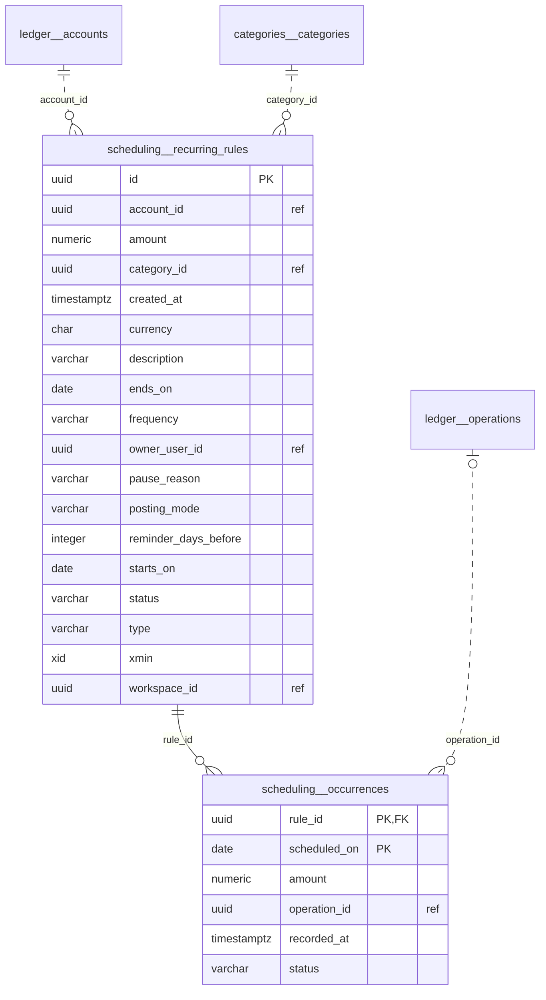

#### `scheduling.recurring_rules`

An income or an expense a person expects on a date, once or every month or year. The rule is a plan: its future dates are calculated, never stored, and only what was registered or skipped leaves a row.

| Columna | Tipo | Nulo | Notas |
|---|---|---|---|
| `id` | uuid | no | PK |
| `account_id` | uuid | no | ref. → `ledger.accounts` (sin FK) |
| `amount` | numeric(18,2) | no |  |
| `category_id` | uuid | no | ref. → `categories.categories` (sin FK) |
| `created_at` | timestamp with time zone | no |  |
| `currency` | character(3) | no |  |
| `description` | character varying(120) | no |  |
| `ends_on` | date | sí |  |
| `frequency` | character varying(16) | no |  |
| `owner_user_id` | uuid | no | ref. → `identity.users` (sin FK) |
| `pause_reason` | character varying(200) | sí |  |
| `posting_mode` | character varying(16) | no |  |
| `reminder_days_before` | integer | sí |  |
| `starts_on` | date | no |  |
| `status` | character varying(16) | no |  |
| `type` | character varying(16) | no |  |
| `xmin` | xid | no | concurrencia optimista |
| `workspace_id` | uuid | no | ref. → `workspaces.workspaces` (sin FK) |

Índices (además de la PK `pk_recurring_rules`):

| Nombre | Columnas | Único | Filtro |
|---|---|---|---|
| `ix_recurring_rules_workspace_id_owner_user_id_status` | `workspace_id`, `owner_user_id`, `status` | no |  |

| Restricción CHECK | Condición |
|---|---|
| `ck_recurring_rules_amount` | `amount > 0` |
| `ck_recurring_rules_frequency` | `frequency IN ('Once', 'Monthly', 'Yearly')` |
| `ck_recurring_rules_period` | `ends_on IS NULL OR ends_on >= starts_on` |
| `ck_recurring_rules_posting_mode` | `posting_mode IN ('Automatic', 'Confirm')` |
| `ck_recurring_rules_status` | `status IN ('Active', 'Paused', 'Ended')` |
| `ck_recurring_rules_type` | `type IN ('Income', 'Expense')` |

#### `scheduling.occurrences`

What happened with a rule on one of its dates. There is one at most per rule and date.

| Columna | Tipo | Nulo | Notas |
|---|---|---|---|
| `rule_id` | uuid | no | PK; FK → `scheduling.recurring_rules` |
| `scheduled_on` | date | no | PK |
| `amount` | numeric(18,2) | no |  |
| `operation_id` | uuid | sí | ref. → `ledger.operations` (sin FK) |
| `recorded_at` | timestamp with time zone | no |  |
| `status` | character varying(16) | no |  |

| Clave foránea | Columnas | Referencia | ON DELETE |
|---|---|---|---|
| `fk_occurrences_recurring_rules_rule_id` | `rule_id` | `scheduling.recurring_rules` | CASCADE |

### Esquema `goals`

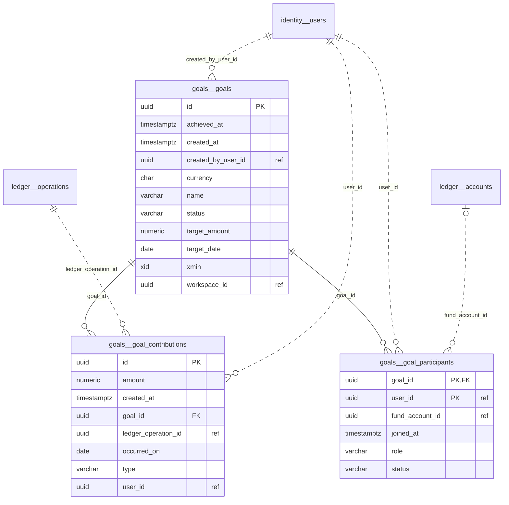

#### `goals.goals`

An amount to save by a date, by one person or by several members of a workspace. It is shared by participation, not by membership: who is not a participant does not know it exists. Each participant keeps their own money in their own fund; the goal only adds up what each one put in.

| Columna | Tipo | Nulo | Notas |
|---|---|---|---|
| `id` | uuid | no | PK |
| `achieved_at` | timestamp with time zone | sí |  |
| `created_at` | timestamp with time zone | no |  |
| `created_by_user_id` | uuid | no | ref. → `identity.users` (sin FK) |
| `currency` | character(3) | no |  |
| `name` | character varying(60) | no |  |
| `status` | character varying(16) | no |  |
| `target_amount` | numeric(18,2) | no |  |
| `target_date` | date | sí |  |
| `xmin` | xid | no | concurrencia optimista |
| `workspace_id` | uuid | no | ref. → `workspaces.workspaces` (sin FK) |

Índices (además de la PK `pk_goals`):

| Nombre | Columnas | Único | Filtro |
|---|---|---|---|
| `ix_goals_workspace_id_status` | `workspace_id`, `status` | no |  |

| Restricción CHECK | Condición |
|---|---|
| `ck_goals_status` | `status IN ('Active', 'Archived', 'Cancelled')` |
| `ck_goals_target_amount` | `target_amount > 0` |

#### `goals.goal_contributions`

What one participant put into the goal or took out of it. Each is tied to one transfer of the ledger between an account of that person and their fund, so the two can always be reconciled.

| Columna | Tipo | Nulo | Notas |
|---|---|---|---|
| `id` | uuid | no | PK |
| `amount` | numeric(18,2) | no |  |
| `created_at` | timestamp with time zone | no |  |
| `goal_id` | uuid | no | FK → `goals.goals` |
| `ledger_operation_id` | uuid | no | ref. → `ledger.operations` (sin FK) |
| `occurred_on` | date | no |  |
| `type` | character varying(16) | no |  |
| `user_id` | uuid | no | ref. → `identity.users` (sin FK) |

Índices (además de la PK `pk_goal_contributions`):

| Nombre | Columnas | Único | Filtro |
|---|---|---|---|
| `ix_goal_contributions_ledger_operation_id` | `ledger_operation_id` | sí |  |
| `ix_goal_contributions_goal_id_occurred_on` | `goal_id`, `occurred_on` | no |  |

| Clave foránea | Columnas | Referencia | ON DELETE |
|---|---|---|---|
| `fk_goal_contributions_goals_goal_id` | `goal_id` | `goals.goals` | CASCADE |

| Restricción CHECK | Condición |
|---|---|
| `ck_goal_contributions_amount` | `amount > 0` |
| `ck_goal_contributions_type` | `type IN ('Contribution', 'Withdrawal')` |

#### `goals.goal_participants`

Someone who saves for the goal. Only an active participant sees it.

| Columna | Tipo | Nulo | Notas |
|---|---|---|---|
| `goal_id` | uuid | no | PK; FK → `goals.goals` |
| `user_id` | uuid | no | PK; ref. → `identity.users` (sin FK) |
| `fund_account_id` | uuid | sí | ref. → `ledger.accounts` (sin FK) |
| `joined_at` | timestamp with time zone | no |  |
| `role` | character varying(16) | no |  |
| `status` | character varying(16) | no |  |

Índices (además de la PK `pk_goal_participants`):

| Nombre | Columnas | Único | Filtro |
|---|---|---|---|
| `ix_goal_participants_one_owner` | `goal_id` | sí | `role = 'Owner' AND status = 'Active'` |
| `ix_goal_participants_user_id_status` | `user_id`, `status` | no |  |

| Clave foránea | Columnas | Referencia | ON DELETE |
|---|---|---|---|
| `fk_goal_participants_goals_goal_id` | `goal_id` | `goals.goals` | CASCADE |

| Restricción CHECK | Condición |
|---|---|
| `ck_goal_participants_role` | `role IN ('Owner', 'Participant')` |
| `ck_goal_participants_status` | `status IN ('Active', 'Left')` |

### Esquema `shared_expenses`

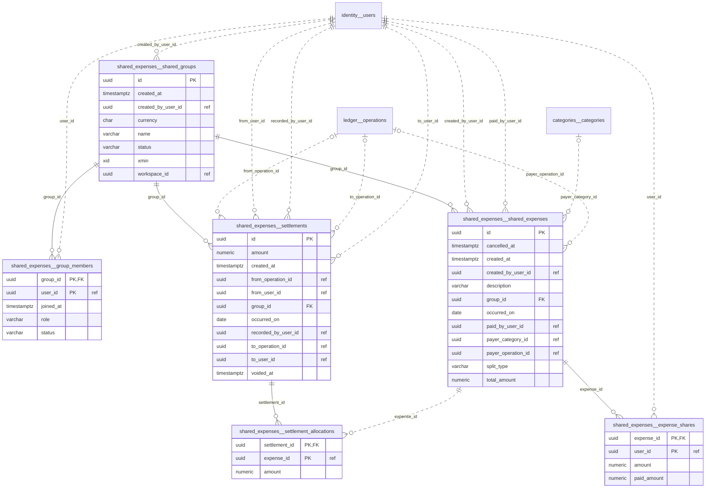

#### `shared_expenses.shared_groups`

People of a workspace who split expenses among themselves. It is shared by membership of the group: who is not in it does not know it exists. The group holds no money: it only keeps who paid what for whom and who repaid; every balance is worked out from that, never stored.

| Columna | Tipo | Nulo | Notas |
|---|---|---|---|
| `id` | uuid | no | PK |
| `created_at` | timestamp with time zone | no |  |
| `created_by_user_id` | uuid | no | ref. → `identity.users` (sin FK) |
| `currency` | character(3) | no |  |
| `name` | character varying(60) | no |  |
| `status` | character varying(16) | no |  |
| `xmin` | xid | no | concurrencia optimista |
| `workspace_id` | uuid | no | ref. → `workspaces.workspaces` (sin FK) |

Índices (además de la PK `pk_shared_groups`):

| Nombre | Columnas | Único | Filtro |
|---|---|---|---|
| `ix_shared_groups_workspace_id_status` | `workspace_id`, `status` | no |  |

| Restricción CHECK | Condición |
|---|---|
| `ck_shared_groups_status` | `status IN ('Active', 'Archived')` |

#### `shared_expenses.group_members`

Someone in a group that splits expenses. Leaving keeps the row, so past expenses stay attributable.

| Columna | Tipo | Nulo | Notas |
|---|---|---|---|
| `group_id` | uuid | no | PK; FK → `shared_expenses.shared_groups` |
| `user_id` | uuid | no | PK; ref. → `identity.users` (sin FK) |
| `joined_at` | timestamp with time zone | no |  |
| `role` | character varying(16) | no |  |
| `status` | character varying(16) | no |  |

Índices (además de la PK `pk_group_members`):

| Nombre | Columnas | Único | Filtro |
|---|---|---|---|
| `ix_group_members_user_id_status` | `user_id`, `status` | no |  |

| Clave foránea | Columnas | Referencia | ON DELETE |
|---|---|---|---|
| `fk_group_members_shared_groups_group_id` | `group_id` | `shared_expenses.shared_groups` | CASCADE |

| Restricción CHECK | Condición |
|---|---|
| `ck_group_members_role` | `role IN ('Admin', 'Member')` |
| `ck_group_members_status` | `status IN ('Active', 'Left')` |

#### `shared_expenses.settlements`

One member repaying another what they owe them in the group. It says who paid, how much and when.

| Columna | Tipo | Nulo | Notas |
|---|---|---|---|
| `id` | uuid | no | PK |
| `amount` | numeric(18,2) | no |  |
| `created_at` | timestamp with time zone | no |  |
| `from_operation_id` | uuid | sí | ref. → `ledger.operations` (sin FK) |
| `from_user_id` | uuid | no | ref. → `identity.users` (sin FK) |
| `group_id` | uuid | no | FK → `shared_expenses.shared_groups` |
| `occurred_on` | date | no |  |
| `recorded_by_user_id` | uuid | no | ref. → `identity.users` (sin FK) |
| `to_operation_id` | uuid | sí | ref. → `ledger.operations` (sin FK) |
| `to_user_id` | uuid | no | ref. → `identity.users` (sin FK) |
| `voided_at` | timestamp with time zone | sí |  |

Índices (además de la PK `pk_settlements`):

| Nombre | Columnas | Único | Filtro |
|---|---|---|---|
| `ix_settlements_group_id_occurred_on` | `group_id`, `occurred_on` | no |  |

| Clave foránea | Columnas | Referencia | ON DELETE |
|---|---|---|---|
| `fk_settlements_shared_groups_group_id` | `group_id` | `shared_expenses.shared_groups` | CASCADE |

| Restricción CHECK | Condición |
|---|---|
| `ck_settlements_amount` | `amount > 0` |

#### `shared_expenses.settlement_allocations`

How much of a payment went to each expense.

| Columna | Tipo | Nulo | Notas |
|---|---|---|---|
| `settlement_id` | uuid | no | PK; FK → `shared_expenses.settlements` |
| `expense_id` | uuid | no | PK; ref. → `shared_expenses.shared_expenses` (sin FK) |
| `amount` | numeric(18,2) | no |  |

| Clave foránea | Columnas | Referencia | ON DELETE |
|---|---|---|---|
| `fk_settlement_allocations_settlements_settlement_id` | `settlement_id` | `shared_expenses.settlements` | CASCADE |

#### `shared_expenses.shared_expenses`

Something one member paid for several. The parts are fixed when it is registered; who paid is owed the part of each of the others, and their own part is paid from the start.

| Columna | Tipo | Nulo | Notas |
|---|---|---|---|
| `id` | uuid | no | PK |
| `cancelled_at` | timestamp with time zone | sí |  |
| `created_at` | timestamp with time zone | no |  |
| `created_by_user_id` | uuid | no | ref. → `identity.users` (sin FK) |
| `description` | character varying(120) | no |  |
| `group_id` | uuid | no | FK → `shared_expenses.shared_groups` |
| `occurred_on` | date | no |  |
| `paid_by_user_id` | uuid | no | ref. → `identity.users` (sin FK) |
| `payer_category_id` | uuid | sí | ref. → `categories.categories` (sin FK) |
| `payer_operation_id` | uuid | sí | ref. → `ledger.operations` (sin FK) |
| `split_type` | character varying(16) | no |  |
| `total_amount` | numeric(18,2) | no |  |

Índices (además de la PK `pk_shared_expenses`):

| Nombre | Columnas | Único | Filtro |
|---|---|---|---|
| `ix_shared_expenses_group_id_occurred_on` | `group_id`, `occurred_on` | no |  |

| Clave foránea | Columnas | Referencia | ON DELETE |
|---|---|---|---|
| `fk_shared_expenses_shared_groups_group_id` | `group_id` | `shared_expenses.shared_groups` | CASCADE |

| Restricción CHECK | Condición |
|---|---|
| `ck_shared_expenses_split_type` | `split_type IN ('Equal', 'Percentage', 'FixedAmount', 'Shares')` |
| `ck_shared_expenses_total` | `total_amount > 0` |

#### `shared_expenses.expense_shares`

What one person owes of an expense, and how much of it they already repaid to whoever paid.

| Columna | Tipo | Nulo | Notas |
|---|---|---|---|
| `expense_id` | uuid | no | PK; FK → `shared_expenses.shared_expenses` |
| `user_id` | uuid | no | PK; ref. → `identity.users` (sin FK) |
| `amount` | numeric(18,2) | no |  |
| `paid_amount` | numeric(18,2) | no |  |

| Clave foránea | Columnas | Referencia | ON DELETE |
|---|---|---|---|
| `fk_expense_shares_shared_expenses_expense_id` | `expense_id` | `shared_expenses.shared_expenses` | CASCADE |

| Restricción CHECK | Condición |
|---|---|
| `ck_expense_shares_amounts` | `amount >= 0 AND paid_amount >= 0 AND paid_amount <= amount` |

### Esquema `integrations`

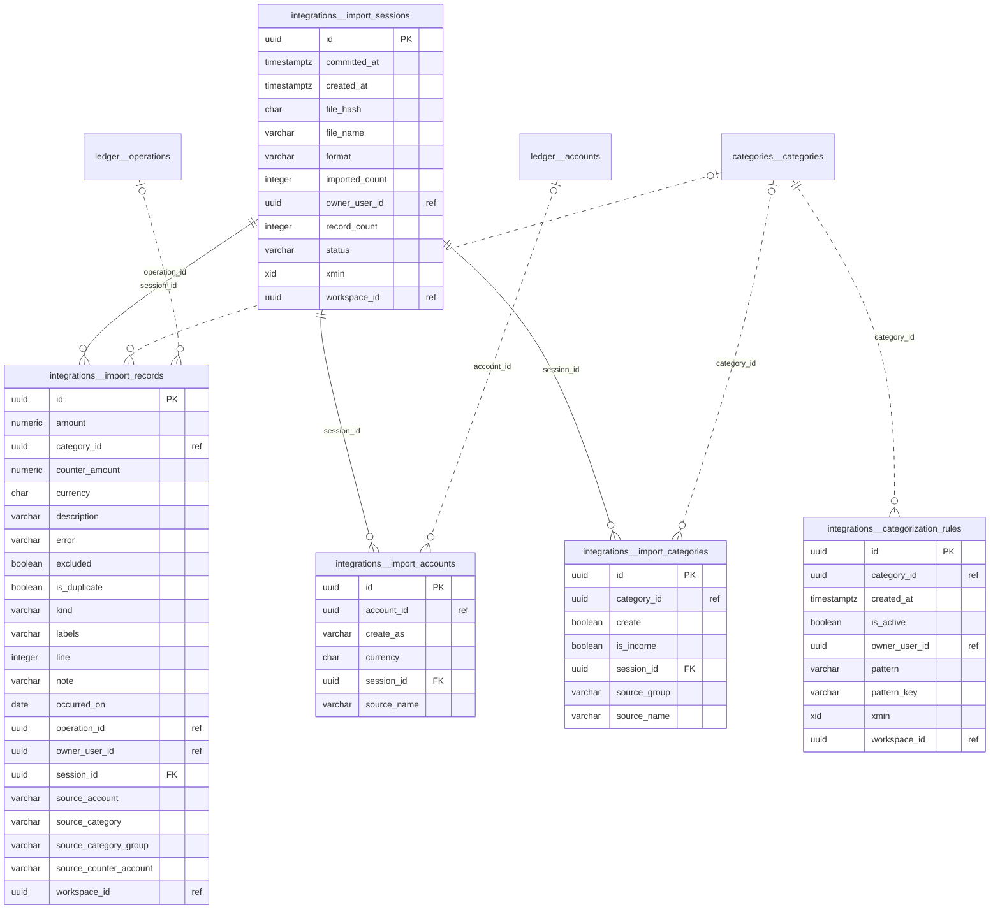

#### `integrations.categorization_rules`

"When the description contains this, it is of this category". A person writes it once and every later file arrives classified. The longest text that matches wins, being the most specific.

| Columna | Tipo | Nulo | Notas |
|---|---|---|---|
| `id` | uuid | no | PK |
| `category_id` | uuid | no | ref. → `categories.categories` (sin FK) |
| `created_at` | timestamp with time zone | no |  |
| `is_active` | boolean | no |  |
| `owner_user_id` | uuid | no | ref. → `identity.users` (sin FK) |
| `pattern` | character varying(60) | no |  |
| `pattern_key` | character varying(120) | no |  |
| `xmin` | xid | no | concurrencia optimista |
| `workspace_id` | uuid | no | ref. → `workspaces.workspaces` (sin FK) |

Índices (además de la PK `pk_categorization_rules`):

| Nombre | Columnas | Único | Filtro |
|---|---|---|---|
| `ix_categorization_rules_owner_pattern` | `workspace_id`, `owner_user_id`, `pattern_key` | sí |  |

#### `integrations.import_records`

One line of an imported file. It is staging: it becomes a movement of the ledger only when the import is confirmed, and from then on the ledger is the only truth about it.

| Columna | Tipo | Nulo | Notas |
|---|---|---|---|
| `id` | uuid | no | PK |
| `amount` | numeric(18,2) | no |  |
| `category_id` | uuid | sí | ref. → `categories.categories` (sin FK) |
| `counter_amount` | numeric(18,2) | sí |  |
| `currency` | character(3) | sí |  |
| `description` | character varying(120) | no |  |
| `error` | character varying(200) | sí |  |
| `excluded` | boolean | sí |  |
| `is_duplicate` | boolean | no |  |
| `kind` | character varying(16) | no |  |
| `labels` | character varying(500) | no |  |
| `line` | integer | no |  |
| `note` | character varying(500) | sí |  |
| `occurred_on` | date | sí |  |
| `operation_id` | uuid | sí | ref. → `ledger.operations` (sin FK) |
| `owner_user_id` | uuid | no | ref. → `identity.users` (sin FK) |
| `session_id` | uuid | no | FK → `integrations.import_sessions` |
| `source_account` | character varying(200) | no |  |
| `source_category` | character varying(200) | no |  |
| `source_category_group` | character varying(200) | sí |  |
| `source_counter_account` | character varying(200) | sí |  |
| `workspace_id` | uuid | no | ref. → `workspaces.workspaces` (sin FK) |

Índices (además de la PK `pk_import_records`):

| Nombre | Columnas | Único | Filtro |
|---|---|---|---|
| `ix_import_records_session_id_line` | `session_id`, `line` | no |  |

| Clave foránea | Columnas | Referencia | ON DELETE |
|---|---|---|---|
| `fk_import_records_import_sessions_session_id` | `session_id` | `integrations.import_sessions` | CASCADE |

| Restricción CHECK | Condición |
|---|---|
| `ck_import_records_kind` | `kind IN ('Income', 'Expense', 'Transfer', 'OpeningBalance')` |

#### `integrations.import_sessions`

A file of movements a person uploaded, from the moment it is read until its movements enter the ledger. It keeps what the person decides while reviewing: which of their accounts each account of the file is, and which of their categories each category of the file is. It belongs to one person, like the ledger it feeds.

| Columna | Tipo | Nulo | Notas |
|---|---|---|---|
| `id` | uuid | no | PK |
| `committed_at` | timestamp with time zone | sí |  |
| `created_at` | timestamp with time zone | no |  |
| `file_hash` | character(64) | no |  |
| `file_name` | character varying(120) | no |  |
| `format` | character varying(16) | no |  |
| `imported_count` | integer | no |  |
| `owner_user_id` | uuid | no | ref. → `identity.users` (sin FK) |
| `record_count` | integer | no |  |
| `status` | character varying(16) | no |  |
| `xmin` | xid | no | concurrencia optimista |
| `workspace_id` | uuid | no | ref. → `workspaces.workspaces` (sin FK) |

Índices (además de la PK `pk_import_sessions`):

| Nombre | Columnas | Único | Filtro |
|---|---|---|---|
| `ix_import_sessions_workspace_id_owner_user_id_created_at` | `workspace_id`, `owner_user_id`, `created_at` | no |  |

| Restricción CHECK | Condición |
|---|---|
| `ck_import_sessions_format` | `format IN ('Csv', 'Bluecoins', 'Ofx', 'Xlsx')` |
| `ck_import_sessions_status` | `status IN ('Review', 'Committed')` |

#### `integrations.import_accounts`

An account as the file names it, and which account of the person it is.

| Columna | Tipo | Nulo | Notas |
|---|---|---|---|
| `id` | uuid | no | PK |
| `account_id` | uuid | sí | ref. → `ledger.accounts` (sin FK) |
| `create_as` | character varying(16) | sí |  |
| `currency` | character(3) | no |  |
| `session_id` | uuid | no | FK → `integrations.import_sessions` |
| `source_name` | character varying(200) | no |  |

Índices (además de la PK `pk_import_accounts`):

| Nombre | Columnas | Único | Filtro |
|---|---|---|---|
| `ix_import_accounts_session_id` | `session_id` | no |  |

| Clave foránea | Columnas | Referencia | ON DELETE |
|---|---|---|---|
| `fk_import_accounts_import_sessions_session_id` | `session_id` | `integrations.import_sessions` | CASCADE |

#### `integrations.import_categories`

A category as the file names it, and which category of the person it is.

| Columna | Tipo | Nulo | Notas |
|---|---|---|---|
| `id` | uuid | no | PK |
| `category_id` | uuid | sí | ref. → `categories.categories` (sin FK) |
| `create` | boolean | no |  |
| `is_income` | boolean | no |  |
| `session_id` | uuid | no | FK → `integrations.import_sessions` |
| `source_group` | character varying(200) | no |  |
| `source_name` | character varying(200) | no |  |

Índices (además de la PK `pk_import_categories`):

| Nombre | Columnas | Único | Filtro |
|---|---|---|---|
| `ix_import_categories_session_id` | `session_id` | no |  |

| Clave foránea | Columnas | Referencia | ON DELETE |
|---|---|---|---|
| `fk_import_categories_import_sessions_session_id` | `session_id` | `integrations.import_sessions` | CASCADE |

### Esquema `investments`

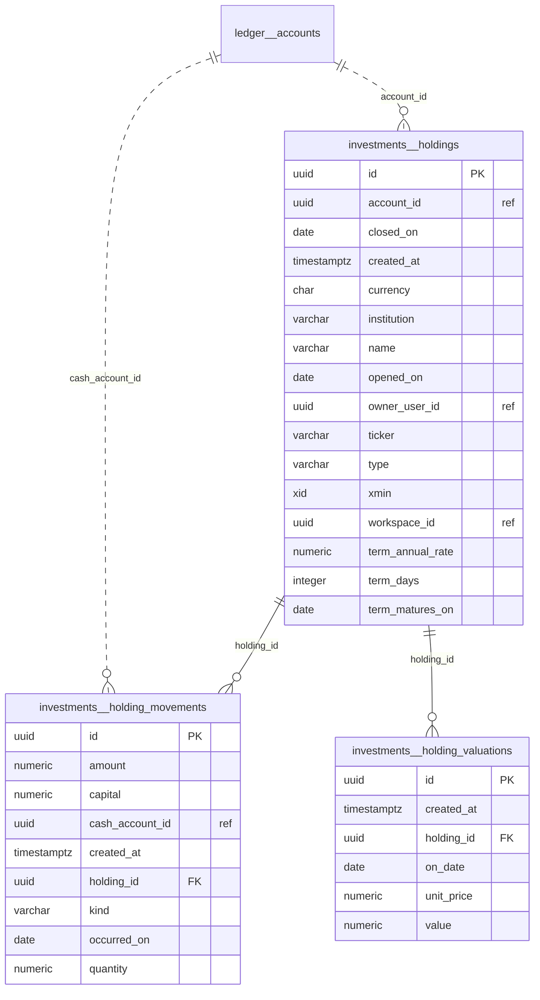

#### `investments.holdings`

One investment of one person: a fund, a term deposit, shares, an ETF or crypto, at an institution. The capital put in lives in an account of the ledger that only this investment moves, so money is counted once; what it is worth comes from the valuations the person records, or from its rate for a term deposit.

| Columna | Tipo | Nulo | Notas |
|---|---|---|---|
| `id` | uuid | no | PK |
| `account_id` | uuid | no | ref. → `ledger.accounts` (sin FK) |
| `closed_on` | date | sí |  |
| `created_at` | timestamp with time zone | no |  |
| `currency` | character(3) | no |  |
| `institution` | character varying(60) | sí |  |
| `name` | character varying(60) | no |  |
| `opened_on` | date | no |  |
| `owner_user_id` | uuid | no | ref. → `identity.users` (sin FK) |
| `ticker` | character varying(15) | sí |  |
| `type` | character varying(16) | no |  |
| `xmin` | xid | no | concurrencia optimista |
| `workspace_id` | uuid | no | ref. → `workspaces.workspaces` (sin FK) |
| `term_annual_rate` | numeric(9,4) | sí |  |
| `term_days` | integer | sí |  |
| `term_matures_on` | date | sí |  |

Índices (además de la PK `pk_holdings`):

| Nombre | Columnas | Único | Filtro |
|---|---|---|---|
| `ix_holdings_account_id` | `account_id` | sí |  |
| `ix_holdings_workspace_id_owner_user_id_closed_on` | `workspace_id`, `owner_user_id`, `closed_on` | no |  |

| Restricción CHECK | Condición |
|---|---|
| `ck_holdings_type` | `type IN ('MutualFund', 'TermDeposit', 'Stock', 'Etf', 'Crypto', 'Other')` |

#### `investments.holding_movements`

Money that went into the investment or came out of it. It mirrors the transfer the ledger registered; a withdrawal also says which part of it was capital and which was gain (or loss).

| Columna | Tipo | Nulo | Notas |
|---|---|---|---|
| `id` | uuid | no | PK |
| `amount` | numeric(18,2) | no |  |
| `capital` | numeric(18,2) | no |  |
| `cash_account_id` | uuid | no | ref. → `ledger.accounts` (sin FK) |
| `created_at` | timestamp with time zone | no |  |
| `holding_id` | uuid | no | FK → `investments.holdings` |
| `kind` | character varying(16) | no |  |
| `occurred_on` | date | no |  |
| `quantity` | numeric(28,8) | sí |  |

Índices (además de la PK `pk_holding_movements`):

| Nombre | Columnas | Único | Filtro |
|---|---|---|---|
| `ix_holding_movements_holding_id` | `holding_id` | no |  |

| Clave foránea | Columnas | Referencia | ON DELETE |
|---|---|---|---|
| `fk_holding_movements_holdings_holding_id` | `holding_id` | `investments.holdings` | CASCADE |

| Restricción CHECK | Condición |
|---|---|
| `ck_holding_movements_amount` | `amount > 0 AND capital >= 0` |
| `ck_holding_movements_kind` | `kind IN ('Contribution', 'Withdrawal')` |

#### `investments.holding_valuations`

What the investment was worth on a day, as the person read it from their bank or broker.

| Columna | Tipo | Nulo | Notas |
|---|---|---|---|
| `id` | uuid | no | PK |
| `created_at` | timestamp with time zone | no |  |
| `holding_id` | uuid | no | FK → `investments.holdings` |
| `on_date` | date | no |  |
| `unit_price` | numeric(28,8) | sí |  |
| `value` | numeric(18,2) | no |  |

Índices (además de la PK `pk_holding_valuations`):

| Nombre | Columnas | Único | Filtro |
|---|---|---|---|
| `ix_holding_valuations_holding_id` | `holding_id` | no |  |

| Clave foránea | Columnas | Referencia | ON DELETE |
|---|---|---|---|
| `fk_holding_valuations_holdings_holding_id` | `holding_id` | `investments.holdings` | CASCADE |

| Restricción CHECK | Condición |
|---|---|
| `ck_holding_valuations_value` | `value >= 0` |

### Esquema `platform`

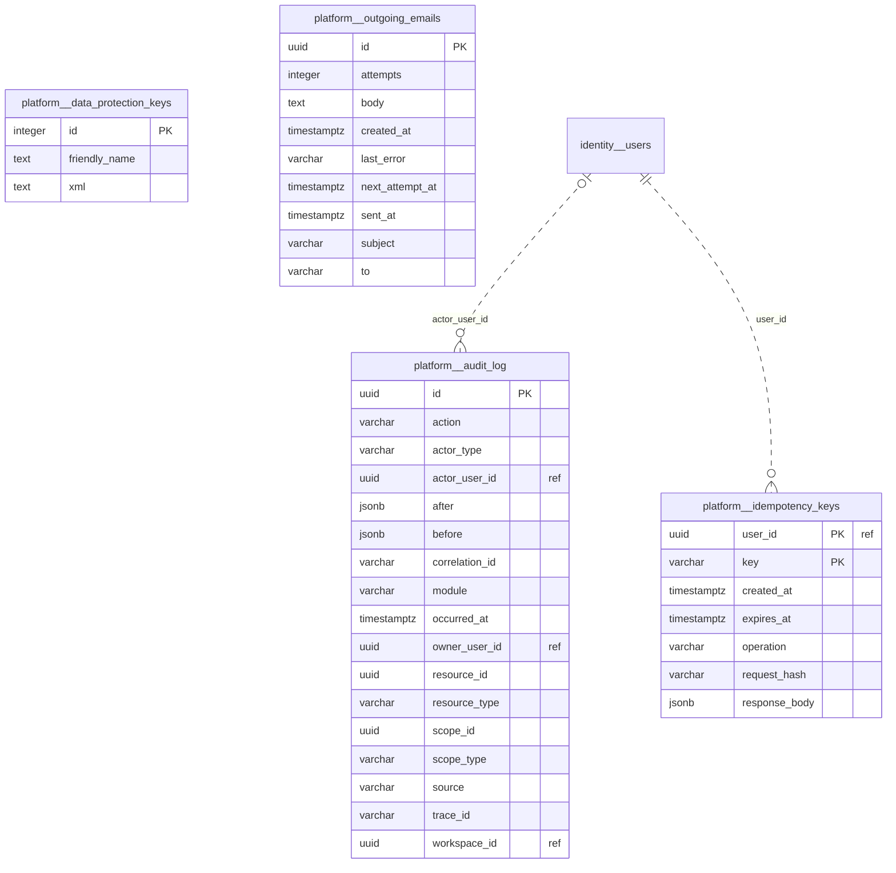

#### `platform.data_protection_keys`

Claves de ASP.NET Core Data Protection: firman la cookie de sesión y los enlaces de los correos.

| Columna | Tipo | Nulo | Notas |
|---|---|---|---|
| `id` | integer | no | PK |
| `friendly_name` | text | sí |  |
| `xml` | text | sí |  |

#### `platform.audit_log`

Functional audit trail entry. Append-only: the application's database role may only insert and read it.

| Columna | Tipo | Nulo | Notas |
|---|---|---|---|
| `id` | uuid | no | PK |
| `action` | character varying(100) | no |  |
| `actor_type` | character varying(16) | no |  |
| `actor_user_id` | uuid | sí | ref. → `identity.users` (sin FK) |
| `after` | jsonb | sí |  |
| `before` | jsonb | sí |  |
| `correlation_id` | character varying(64) | sí |  |
| `module` | character varying(50) | no |  |
| `occurred_at` | timestamp with time zone | no |  |
| `owner_user_id` | uuid | sí | ref. → `identity.users` (sin FK) |
| `resource_id` | uuid | no |  |
| `resource_type` | character varying(100) | no |  |
| `scope_id` | uuid | sí |  |
| `scope_type` | character varying(100) | sí |  |
| `source` | character varying(32) | no |  |
| `trace_id` | character varying(32) | sí |  |
| `workspace_id` | uuid | sí | ref. → `workspaces.workspaces` (sin FK) |

Índices (además de la PK `pk_audit_log`):

| Nombre | Columnas | Único | Filtro |
|---|---|---|---|
| `ix_audit_log_resource_type_resource_id_occurred_at` | `resource_type`, `resource_id`, `occurred_at` | no |  |
| `ix_audit_log_scope_type_scope_id_occurred_at` | `scope_type`, `scope_id`, `occurred_at` | no |  |

#### `platform.idempotency_keys`

The stored outcome of an idempotent command, returned again when the same key is replayed.

| Columna | Tipo | Nulo | Notas |
|---|---|---|---|
| `user_id` | uuid | no | PK; ref. → `identity.users` (sin FK) |
| `key` | character varying(100) | sí | PK |
| `created_at` | timestamp with time zone | no |  |
| `expires_at` | timestamp with time zone | no |  |
| `operation` | character varying(300) | no |  |
| `request_hash` | character varying(64) | no |  |
| `response_body` | jsonb | no |  |

Índices (además de la PK `pk_idempotency_keys`):

| Nombre | Columnas | Único | Filtro |
|---|---|---|---|
| `ix_idempotency_keys_expires_at` | `expires_at` | no |  |

#### `platform.outgoing_emails`

An email waiting to be sent. Written in the transaction of the command that needs it and sent by a Worker job, so a mail outage never fails a command. The body is erased once sent: it may carry a one-time link.

| Columna | Tipo | Nulo | Notas |
|---|---|---|---|
| `id` | uuid | no | PK |
| `attempts` | integer | no |  |
| `body` | text | sí |  |
| `created_at` | timestamp with time zone | no |  |
| `last_error` | character varying(1000) | sí |  |
| `next_attempt_at` | timestamp with time zone | no |  |
| `sent_at` | timestamp with time zone | sí |  |
| `subject` | character varying(200) | no |  |
| `to` | character varying(254) | no |  |

Índices (además de la PK `pk_outgoing_emails`):

| Nombre | Columnas | Único | Filtro |
|---|---|---|---|
| `ix_outgoing_emails_next_attempt_at` | `next_attempt_at` | no | `sent_at IS NULL` |

<!-- generated:end -->
