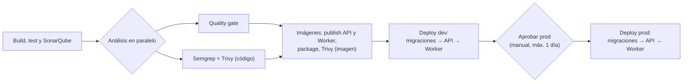

# Integración y despliegue continuos

Cómo se construye, se comprueba y se despliega cada repositorio en Jenkins (servidor Mercury), y cómo cambiar los pipelines. El despliegue en sí (y cómo hacerlo en otro servidor) está en [deployment.md](deployment.md).

## Dos repositorios, dos pipelines

| Repositorio | Jenkinsfile | Job de Jenkins | Agente | Produce |
|---|---|---|---|---|
| Principal (backend + docs) | `finanzas-hub-api/Jenkinsfile` | Carpeta `dotnet`, Script Path `finanzas-hub-api/Jenkinsfile` | `dotnet-10.0` | Imágenes `finanzas-hub-api` y `finanzas-hub-worker` |
| `finanzas-hub-web` | `finanzas-hub-web/Jenkinsfile` | Carpeta `javascript/angular`, Script Path `Jenkinsfile` | `node-22` | Imagen `finanzas-hub-web` |

Un push nuevo cancela el build anterior del mismo job, aunque esté esperando aprobación (`disableConcurrentBuilds(abortPrevious: true)`). Se guardan los últimos 20 builds.

## Pipeline del backend



| Etapa | Qué hace | Si falla |
|---|---|---|
| Build, test y SonarQube | `dotnet sonarscanner begin`, `restore`, `build -c Release` (avisos = errores), tests **unitarios, de arquitectura y de integración** (estos contra un PostgreSQL de un solo uso), `sonarscanner end`. Excluye `Migrations/**` y `tools/**` del análisis ([excepciones](#quality-gate-y-excepciones-de-sonarqube)) | No sigue |
| Quality gate | Espera el veredicto de SonarQube (10 min) | Aborta el pipeline |
| Seguridad | `mercury-ci semgrep` (SAST, archiva `semgrep.json`), `mercury-ci trivy-fs` (dependencias vulnerables) y `gitleaks` sobre los archivos con `.gitleaks.toml` (secretos en el código; el binario del agente o la imagen `zricethezav/gitleaks:v8.21.2`) | Aborta |
| Imágenes | `dotnet publish` de API y Worker sin recompilar, `mercury-ci package dotnet` con la `Dockerfile` del repo, `mercury-ci trivy-image` | Aborta |
| Deploy dev | Comprueba los `.env` del ambiente, descarga la imagen, aplica migraciones en un contenedor de un solo uso y despliega API y Worker (256 MB) | Si la migración falla, no se despliega nada |
| Aprobar prod | `input` manual; sin agente, así que no ocupa recursos mientras espera | Caduca al día |
| Deploy prod | Copia de la base (`tools/backup.sh`) y lo mismo que dev con las **mismas imágenes** | Sin copia no se migra ni se despliega |

**Los tests de integración corren en el CI desde la 1.0**, dentro de la etapa de build. Testcontainers no sirve en el agente, que usa el Docker del host y no llegaría a los puertos que publica. Por eso la etapa arranca un `postgres:18-alpine` de un solo uso con `--network container:$(hostname)`: comparte la red del agente y los tests lo ven en `localhost:5432` (`PERSONALFINANCE_TEST_POSTGRES`). Al terminar se borra.

En **Deploy prod**, antes de migrar, se ejecuta [`tools/backup.sh`](../../finanzas-hub-api/tools/backup.sh) con `/srv/mercury/apps/prod/finanzas-hub-backup.env`. Prod corre sin checkout, así que el script llega por `stash` desde la etapa de imágenes. Si existe `finanzas-hub-migrate.env`, `migrate` usa su cadena de conexión, la del dueño de las tablas ([secrets.md](secrets.md)), sin trazarla.

## Pipeline del frontend

| Etapa | Qué hace |
|---|---|
| Build, lint y tests | `npm ci`, `npm run lint`, `npm test -- --watch=false` (Vitest + jsdom, sin navegador), `npm run build` |
| SonarQube | `mercury-ci sonar`, excluyendo `node_modules`, `dist`, `.angular`, `e2e`, `test-results` y el `schema.ts` generado, con dos reglas de HTML ignoradas ([excepciones](#quality-gate-y-excepciones-de-sonarqube)) |
| Análisis | Quality gate, Semgrep, Trivy y gitleaks en paralelo |
| Imagen | `mercury-ci package spa dist/finanzas-hub-web/browser` con la `Dockerfile` del repo, y Trivy sobre la imagen |
| Deploy dev / Aprobar prod / Deploy prod | `mercury-ci deploy finanzas-hub-web <env>` con 128 MB |

Los E2E de Playwright no corren en el CI.

## Quality gate y excepciones de SonarQube

Los dos proyectos usan el gate **PersonalHub** del servidor, una copia de *Sonar way* **sin la condición de cobertura**: cero problemas nuevos, duplicación ≤ 3 % y hotspots revisados al 100 %. La cobertura no se exige porque no se recoge y el proyecto mantiene pocos tests clave; un 80 % sobre el código nuevo obligaría a escribir tests por la cifra.

Un problema nuevo se corrige. Lo que se ignora está en el Jenkinsfile, con su motivo:

| Proyecto | Qué | Por qué |
|---|---|---|
| API | `tools/**` excluido | Scripts de mantenimiento (`update-db-docs.mjs`…), no código de la aplicación |
| API | `csharpsquid:S107` (más de 7 parámetros) | Lo disparan los constructores de DI de los handlers y las fábricas de dominio; un objeto de parámetros solo movería la lista |
| Web | `Web:InputWithoutLabelCheck` en `*.html` | `<app-field>` envuelve el control en su `<label>` mediante `<ng-content>`, que el análisis de HTML no ve |
| Web | `Web:S6819` en `*.html` | La app usa roles ARIA (`status`, `group`, `img`), válidos, en lugar de `<output>` o `<fieldset>`, que traen estilos propios |

Un caso puntual que no merezca una regla se marca en SonarQube como *Accepted* o *False positive*, con un comentario.

## Reglas del pipeline

- **Una imagen se construye una vez** y se promueve de dev a prod; nunca se recompila para prod.
- **La etiqueta es el número de build** de Jenkins: cada despliegue se puede repetir o revertir con la etiqueta anterior.
- **Migraciones antes que código**, con la imagen nueva y en un contenedor aparte; si fallan, siguen las versiones anteriores.
- **Los Jenkinsfile no contienen secretos**: nombran credenciales de Jenkins (`registry`, `sonarqube`) y leen la configuración de cada app de `/srv/mercury/apps/<env>/` ([secrets.md](secrets.md)).
- **Seguridad bloqueante**: un hallazgo de Semgrep o Trivy por encima del umbral o un quality gate rojo paran el despliegue. No se desactivan para «sacar algo rápido»: se corrige o se documenta la excepción.

## Antes de subir

El CI comprueba menos que tu máquina. Antes de un push a `main`:

```powershell
# finanzas-hub-api
dotnet build PersonalFinance.slnx
dotnet test PersonalFinance.slnx          # incluye los de integración (el CI también los corre)

# finanzas-hub-web
npm run lint; npm test -- --watch=false; npm run build
npm run e2e                               # si tocaste un recorrido crítico
```

## Cambiar un pipeline

| Quiero | Cambio |
|---|---|
| Un ambiente nuevo (`staging`) | Crear `/srv/mercury/apps/staging/*.env`, la base y su usuario; añadir una etapa con `deployAll('staging')` (backend) o `mercury-ci deploy "$APP" staging "$TAG"` (frontend) |
| Más memoria para un contenedor | `APP_MEM_LIMIT` en la llamada a `mercury-ci deploy` |
| Cambiar el PostgreSQL de los tests de integración | La imagen y la cadena `PERSONALFINANCE_TEST_POSTGRES` en la etapa de build |
| Otra herramienta de análisis | Una etapa más dentro de `Análisis` (en paralelo) |
| Otro proveedor de CI (GitHub Actions, GitLab…) | Mismos pasos, sustituyendo cada `mercury-ci` por su equivalente de [deployment.md §3 y §5](deployment.md#3-construir-los-artefactos) |

Prueba los cambios del Jenkinsfile en una rama: el job compila cualquier rama. Con git flow, cualquier rama que llegue a las etapas de deploy va a **dev**, pero «Aprobar prod» y «Deploy prod» solo se ejecutan en `main` (`when { expression { !env.BRANCH_NAME || env.BRANCH_NAME == 'main' } }`). Las ramas: [workflow.md § Git](../getting-started/workflow.md#4-git).
