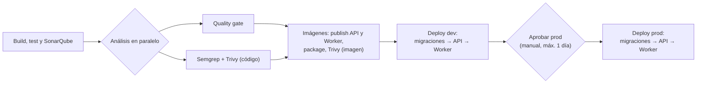

# Integración y despliegue continuos

Cómo se construye, se comprueba y se despliega cada repositorio en Jenkins (servidor Mercury), y cómo cambiar los pipelines. El despliegue en sí (y cómo hacerlo en otro servidor) está en [deployment.md](deployment.md).

## Dos repositorios, dos pipelines

| Repositorio | Jenkinsfile | Job de Jenkins | Agente | Produce |
|---|---|---|---|---|
| Principal (backend + docs) | `finanzas-hub-api/Jenkinsfile` | Carpeta `dotnet`, Script Path `finanzas-hub-api/Jenkinsfile` | `dotnet-10.0` | Imágenes `finanzas-hub-api` y `finanzas-hub-worker` |
| `finanzas-hub-web` | `finanzas-hub-web/Jenkinsfile` | Carpeta `javascript/angular`, Script Path `Jenkinsfile` | `node-22` | Imagen `finanzas-hub-web` |

Un push nuevo cancela el build anterior del mismo job, aunque esté esperando aprobación (`disableConcurrentBuilds(abortPrevious: true)`). Se guardan los últimos 20 builds.

## Pipeline del backend



| Etapa | Qué hace | Si falla |
|---|---|---|
| Build, test y SonarQube | `dotnet sonarscanner begin`, `restore`, `build -c Release` (avisos = errores), tests **unitarios y de arquitectura**, `sonarscanner end`. Excluye `Migrations/**` del análisis | No sigue |
| Quality gate | Espera el veredicto de SonarQube (10 min) | Aborta el pipeline |
| Seguridad | `mercury-ci semgrep` (SAST, archiva `semgrep.json`) y `mercury-ci trivy-fs` (dependencias vulnerables) | Aborta |
| Imágenes | `dotnet publish` de API y Worker sin recompilar, `mercury-ci package dotnet` con la `Dockerfile` del repo, `mercury-ci trivy-image` | Aborta |
| Deploy dev | Comprueba los `.env` del ambiente, descarga la imagen, aplica migraciones en un contenedor de un solo uso y despliega API y Worker (256 MB) | Si la migración falla, no se despliega nada |
| Aprobar prod | `input` manual; sin agente, así que no ocupa recursos mientras espera | Caduca al día |
| Deploy prod | Lo mismo que dev con las **mismas imágenes** | Igual |

**Los tests de integración no corren en el CI**: el agente no tiene Docker para Testcontainers. Se ejecutan en local antes de subir ([backend/testing.md](../backend/testing.md)).

## Pipeline del frontend

| Etapa | Qué hace |
|---|---|
| Build, lint y tests | `npm ci`, `npm run lint`, `npm test -- --watch=false` (Vitest + jsdom, sin navegador), `npm run build` |
| SonarQube | `mercury-ci sonar`, excluyendo `node_modules`, `dist`, `.angular`, `e2e`, `test-results` y el `schema.ts` generado |
| Análisis | Quality gate, Semgrep y Trivy en paralelo |
| Imagen | `mercury-ci package spa dist/finanzas-hub-web/browser` con la `Dockerfile` del repo, y Trivy sobre la imagen |
| Deploy dev / Aprobar prod / Deploy prod | `mercury-ci deploy finanzas-hub-web <env>` con 128 MB |

Los E2E de Playwright no corren en el CI.

## Reglas del pipeline

- **Una imagen se construye una vez** y se promueve de dev a prod; nunca se recompila para prod.
- **La etiqueta es el número de build** de Jenkins: cada despliegue se puede repetir o revertir con la etiqueta anterior.
- **Migraciones antes que código**, con la imagen nueva y en un contenedor aparte; si fallan, siguen las versiones anteriores.
- **Los Jenkinsfile no contienen secretos**: nombran credenciales de Jenkins (`registry`, `sonarqube`) y leen la configuración de cada app de `/srv/mercury/apps/<env>/` ([secrets.md](secrets.md)).
- **Seguridad bloqueante**: un hallazgo de Semgrep o Trivy por encima del umbral o un quality gate rojo paran el despliegue. No se desactivan para «sacar algo rápido»: se corrige o se documenta la excepción.

## Antes de subir

El CI comprueba menos que tu máquina. Antes de un push a `main`:

```powershell
# finanzas-hub-api
dotnet build PersonalFinance.slnx
dotnet test PersonalFinance.slnx          # incluye los de integración, que el CI no corre

# finanzas-hub-web
npm run lint; npm test -- --watch=false; npm run build
npm run e2e                               # si tocaste un recorrido crítico
```

## Cambiar un pipeline

| Quiero | Cambio |
|---|---|
| Un ambiente nuevo (`staging`) | Crear `/srv/mercury/apps/staging/*.env`, la base y su usuario; añadir una etapa con `deployAll('staging')` (backend) o `mercury-ci deploy "$APP" staging "$TAG"` (frontend) |
| Más memoria para un contenedor | `APP_MEM_LIMIT` en la llamada a `mercury-ci deploy` |
| Correr los tests de integración | Un agente con Docker, o un PostgreSQL de servicio y `PERSONALFINANCE_TEST_POSTGRES` en la etapa de test |
| Otra herramienta de análisis | Una etapa más dentro de `Análisis` (en paralelo) |
| Otro proveedor de CI (GitHub Actions, GitLab…) | Mismos pasos, sustituyendo cada `mercury-ci` por su equivalente de [deployment.md §3 y §5](deployment.md#3-construir-los-artefactos) |

Prueba los cambios del Jenkinsfile en una rama: el job compila cualquier rama, pero solo despliega lo que llega a las etapas de deploy.
