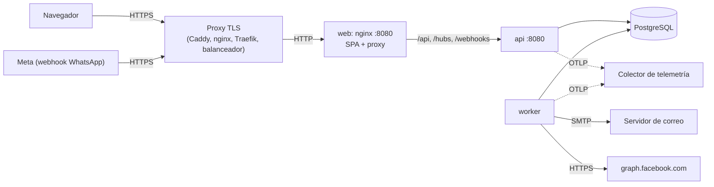

# Despliegue

Cómo poner PersonalHub en marcha en un servidor: qué se despliega, qué necesita de la plataforma, cómo se construyen los artefactos y tres maneras de desplegarlo (un servidor con Docker Compose, un servidor sin Docker y una plataforma de contenedores gestionada). Al final está cómo se hace hoy en Mercury, el servidor propio, que es un caso particular de lo anterior.

Los secretos y dónde se guardan están en [secrets.md](secrets.md); las claves de configuración, en [onboarding.md §8](../getting-started/onboarding.md#8-configuración-y-variables-de-entorno).

---

## 1. Qué se despliega

| Pieza | Artefacto | Puerto | Instancias |
|---|---|---|---|
| API (`PersonalFinance.Api`) | Imagen con [`finanzas-hub-api/Dockerfile`](../../finanzas-hub-api/Dockerfile) sobre `dotnet publish` | 8080 (HTTP) | **1** (ver §2) |
| Worker (`PersonalFinance.Worker`) | La **misma** Dockerfile, sobre la publicación del Worker | Ninguno | **1** |
| Frontend | Imagen nginx con [`finanzas-hub-web/Dockerfile`](../../finanzas-hub-web/Dockerfile) sobre `npm run build` | 8080 (HTTP) | Las que quieras |
| Base de datos | PostgreSQL 17 (gestionado o en contenedor) | 5432 | 1 |
| Migraciones | La imagen de la API con el argumento `migrate`: aplica y termina | — | Una ejecución por despliegue |

Servicios externos opcionales: un servidor SMTP (correos), la Cloud API de WhatsApp (Meta) y un colector OTLP (telemetría). Sin ellos la aplicación funciona: los correos y los WhatsApp se escriben como archivos y la telemetría no se exporta.



La API y el Worker no se hablan: comparten la base. La API escribe en las colas (`platform.outgoing_emails`, `notifications.deliveries`) y el Worker las procesa.

---

## 2. Requisitos de la plataforma

Antes de elegir dónde desplegar, comprueba que la plataforma cumple esto:

| Requisito | Por qué |
|---|---|
| **HTTPS de cara al navegador** | En Production la cookie de sesión `ph.session` lleva `Secure`: sin HTTPS el navegador no la guarda y nadie puede iniciar sesión. La API escucha en HTTP; el TLS lo termina el proxy |
| **Frontend y API en el mismo origen** (mismo dominio) | La sesión es una cookie `SameSite=Lax`. Lo más simple es que el navegador solo hable con el frontend y este reenvíe `/api`, `/hubs` y `/webhooks` a la API, como hace la imagen nginx |
| **WebSockets** hasta la API, con tiempo de espera largo (≥ 1 h) | SignalR (`/hubs/realtime`) para avisos en tiempo real. Si no hay WebSockets, el cliente cae a long polling, que funciona peor |
| **Peticiones de hasta 11 MB** | Importación de archivos de banco (10 MB más el formulario) |
| **Una sola instancia de la API** | El hub de SignalR y el limitador de peticiones viven en memoria. Para más de una hace falta un backplane de SignalR y sesiones pegajosas ([azure.md](azure.md)) |
| **Una sola instancia del Worker, siempre encendida** | Los jobs se ejecutan cada pocos minutos sin que llegue ninguna petición. Una plataforma que escala a cero o que solo da CPU mientras atiende peticiones no sirve para el Worker |
| **PostgreSQL 17** accesible desde la API, el Worker y el paso de migraciones | Una sola base para todo |
| **Un paso previo al despliegue** que ejecute las migraciones | Las migraciones no se aplican al arrancar fuera de Development |
| Salida a Internet desde el Worker | SMTP y `graph.facebook.com`, si se usan |
| Entrada pública a `/webhooks/v1/whatsapp` | Solo si se usa WhatsApp: Meta llama a esa URL |

---

## 3. Construir los artefactos

Es lo mismo en cualquier destino. Necesitas el SDK de .NET 10, Node 24 y Docker con BuildKit (activado por defecto desde Docker 23; el Dockerfile del frontend usa `COPY <<EOF`).

```bash
# Backend (desde finanzas-hub-api)
dotnet publish src/PersonalFinance.Api/PersonalFinance.Api.csproj       -c Release -o publish/api
dotnet publish src/PersonalFinance.Worker/PersonalFinance.Worker.csproj -c Release -o publish/worker

# La Dockerfile empaqueta una carpeta ya publicada: el contexto es esa carpeta.
docker build -f Dockerfile -t registro.ejemplo.com/finanzas-hub-api:1.0.0    publish/api
docker build -f Dockerfile -t registro.ejemplo.com/finanzas-hub-worker:1.0.0 publish/worker

# Frontend (desde finanzas-hub-web)
npm ci
npm run build
docker build -f Dockerfile -t registro.ejemplo.com/finanzas-hub-web:1.0.0 dist/finanzas-hub-web/browser

docker push registro.ejemplo.com/finanzas-hub-api:1.0.0      # y las otras dos
```

Detalles de las imágenes:

- **API y Worker** usan `mcr.microsoft.com/dotnet/aspnet:10.0`, corren con un usuario sin privilegios (`$APP_UID`) y deducen qué ensamblado arrancar del único `*.runtimeconfig.json` de la carpeta (`APP_DLL` lo fija a mano si hiciera falta). Los argumentos llegan a la aplicación: `docker run <imagen-api> migrate` aplica las migraciones y termina.
- **Web** usa `nginx-unprivileged` en el puerto 8080. Sirve el SPA con caché inmutable para los archivos con hash y reenvía `/api/`, `/hubs/` y `/webhooks/` a `http://${API_UPSTREAM}`. **Sin `API_UPSTREAM` el contenedor no arranca.**
- La imagen de la web resuelve la API con el DNS interno de Docker (`resolver 127.0.0.11`). Funciona con Docker y Docker Compose; **en Kubernetes o en una plataforma gestionada ese resolver no existe** y hay que adaptarlo (ver §6.3).
- Ninguna imagen trae `curl` ni `wget`: comprueba la salud desde fuera (`/health/live`, `/health/ready`).

Usa como etiqueta un número de build o el hash del commit, nunca `latest`: así puedes volver a la versión anterior.

---

## 4. Configuración por contenedor

En el contenedor `ASPNETCORE_ENVIRONMENT` (o `DOTNET_ENVIRONMENT`) vale `Production` por defecto: no lo pongas a `Development` en un servidor.

### API

| Variable | Obligatoria | Ejemplo |
|---|---|---|
| `ConnectionStrings__PersonalFinance` | **Sí**: sin ella no arranca | `Host=db;Port=5432;Database=personal_hub;Username=personal_hub_app;Password=...;SSL Mode=Prefer` |
| `Cors__AllowedOrigins__0` | **Sí**: en Production exige al menos un origen HTTPS o no arranca | `https://finanzas.ejemplo.com` (la URL pública exacta del frontend, sin barra final) |
| `Frontend__BaseUrl` | Sí, en la práctica | `https://finanzas.ejemplo.com`: los enlaces de los correos empiezan así |
| `WhatsApp__VerifyToken`, `WhatsApp__AppSecret` | Si usas WhatsApp | Ver [secrets.md](secrets.md) |
| `OTEL_EXPORTER_OTLP_ENDPOINT` | No | `http://otel-collector:4317`. Sin ella los logs solo van a la salida estándar |
| `RateLimiting__AuthPermitsPerMinute` | No | 20 por defecto |

### Worker

| Variable | Obligatoria | Ejemplo |
|---|---|---|
| `ConnectionStrings__PersonalFinance` | **Sí** | La misma que la API |
| `Frontend__BaseUrl` | Sí, en la práctica | La misma que la API |
| `Email__SmtpHost`, `Email__SmtpPort`, `Email__SmtpUser`, `Email__SmtpPassword`, `Email__From` | Para enviar correos | Sin `SmtpHost` se escriben como `.eml` dentro del contenedor y nadie los recibe |
| `WhatsApp__AccessToken`, `WhatsApp__PhoneNumberId`, `WhatsApp__NoticeTemplate`, `WhatsApp__CodeTemplate` | Para enviar WhatsApp | |
| `OTEL_EXPORTER_OTLP_ENDPOINT` | No | |

### Web

| Variable | Obligatoria | Ejemplo |
|---|---|---|
| `API_UPSTREAM` | **Sí** | `api:8080` (host:puerto de la API visto desde el contenedor web) |

Guarda estas variables en un fichero `.env` por servicio, fuera del repositorio y legible solo por quien despliega, o en el gestor de secretos de la plataforma.

---

## 5. Orden de un despliegue

1. **Copia de la base** (`pg_dump` o la copia a un punto en el tiempo de tu proveedor). Las migraciones solo van hacia delante: si una sale mal, se vuelve restaurando.
2. **Migraciones** con la imagen **nueva** de la API, en un contenedor de un solo uso:
   ```bash
   docker run --rm --env-file api.env registro.ejemplo.com/finanzas-hub-api:1.0.1 migrate
   ```
   Si fallan, no sigas: la versión anterior sigue funcionando con la base sin tocar. Nunca dejes que dos procesos migren a la vez.
3. **API** con la imagen nueva.
4. **Worker** con la imagen nueva. Si arranca antes que la migración, sus jobs fallan, lo registran y reintentan al minuto: no se pierde nada.
5. **Web**. Es independiente: se despliega con su propio ritmo, pero si un cambio de frontend depende de un endpoint nuevo, después de la API.
6. **Comprobaciones** de la §8.

**Volver atrás**: vuelve a desplegar las etiquetas anteriores de API, Worker y web. Solo es seguro si las migraciones de la versión nueva son compatibles con el código anterior (añadir tablas o columnas que admiten nulos lo es; renombrar o borrar no). Si no lo son, restaura la copia del paso 1.

---

## 6. Escenarios

### 6.1 Un servidor con Docker Compose (VPS, máquina propia)

La opción más simple para unos 10 usuarios: una máquina Linux con Docker, todo en un `compose.yaml`, y Caddy delante para el HTTPS automático con Let's Encrypt. Crea una carpeta en el servidor (`/opt/personalhub`) con estos ficheros, que **no** van al repositorio:

```yaml
# /opt/personalhub/compose.yaml
services:
  db:
    image: postgres:17-alpine
    environment:
      POSTGRES_DB: personal_hub
      POSTGRES_USER: personal_hub
      POSTGRES_PASSWORD: ${POSTGRES_PASSWORD}
    volumes:
      - pgdata:/var/lib/postgresql/data
    healthcheck:
      test: ["CMD-SHELL", "pg_isready -U personal_hub -d personal_hub"]
      interval: 10s
    restart: unless-stopped

  api:
    image: registro.ejemplo.com/finanzas-hub-api:${TAG}
    env_file: api.env
    depends_on:
      db: { condition: service_healthy }
    restart: unless-stopped

  worker:
    image: registro.ejemplo.com/finanzas-hub-worker:${TAG}
    env_file: worker.env
    depends_on:
      db: { condition: service_healthy }
    restart: unless-stopped

  web:
    image: registro.ejemplo.com/finanzas-hub-web:${WEB_TAG}
    environment:
      API_UPSTREAM: api:8080
    depends_on: [api]
    restart: unless-stopped

  caddy:
    image: caddy:2
    ports: ["80:80", "443:443"]
    volumes:
      - ./Caddyfile:/etc/caddy/Caddyfile:ro
      - caddy_data:/data
    restart: unless-stopped

volumes:
  pgdata:
  caddy_data:
```

```text
# /opt/personalhub/Caddyfile — Caddy obtiene y renueva el certificado solo
finanzas.ejemplo.com {
    reverse_proxy web:8080
}
```

```bash
# /opt/personalhub/.env   (lo lee docker compose; chmod 600)
POSTGRES_PASSWORD=<contraseña larga>
TAG=1.0.1
WEB_TAG=1.0.1
```

`api.env` y `worker.env` llevan las variables de la §4, con `Host=db` en la cadena de conexión. Para desplegar:

```bash
cd /opt/personalhub
pg_dump ...                                                     # o: docker compose exec db pg_dump -U personal_hub personal_hub > copia.sql
docker compose pull
docker compose run --rm api migrate                             # el argumento llega a la aplicación
docker compose up -d
```

La base no expone puertos fuera de la red de Compose. El DNS apunta a la IP del servidor y el cortafuegos solo deja abiertos el 80, el 443 y el SSH.

### 6.2 Un servidor sin Docker (systemd + nginx)

Para una VM donde no quieres contenedores. Instala el runtime de ASP.NET Core 10, PostgreSQL 17 y nginx.

```bash
# En la máquina de build
dotnet publish src/PersonalFinance.Api/PersonalFinance.Api.csproj       -c Release -o out/api
dotnet publish src/PersonalFinance.Worker/PersonalFinance.Worker.csproj -c Release -o out/worker
npm run build                                                   # en finanzas-hub-web
# Copia out/api a /opt/personalhub/api, out/worker a /opt/personalhub/worker
# y dist/finanzas-hub-web/browser a /var/www/personalhub
```

```ini
# /etc/systemd/system/personalhub-api.service
[Unit]
Description=PersonalHub API
After=network.target postgresql.service

[Service]
WorkingDirectory=/opt/personalhub/api
ExecStart=/usr/bin/dotnet PersonalFinance.Api.dll
Environment=ASPNETCORE_URLS=http://127.0.0.1:5080
EnvironmentFile=/etc/personalhub/api.env
User=personalhub
Restart=always

[Install]
WantedBy=multi-user.target
```

El Worker lleva una unidad igual (`personalhub-worker.service`) con `PersonalFinance.Worker.dll`, `EnvironmentFile=/etc/personalhub/worker.env` y sin `ASPNETCORE_URLS`. Los `.env` de `/etc/personalhub` con `chmod 600` y dueño `personalhub`.

```nginx
# /etc/nginx/sites-available/personalhub — el TLS con certbot (certbot --nginx -d finanzas.ejemplo.com)
map $http_upgrade $connection_upgrade { default upgrade; '' ''; }

server {
    server_name finanzas.ejemplo.com;
    root /var/www/personalhub;
    client_max_body_size 11m;

    proxy_http_version 1.1;
    proxy_set_header Host $host;
    proxy_set_header X-Forwarded-For $proxy_add_x_forwarded_for;
    proxy_set_header X-Forwarded-Proto $scheme;
    proxy_set_header Upgrade $http_upgrade;
    proxy_set_header Connection $connection_upgrade;

    location ^~ /api/      { proxy_pass http://127.0.0.1:5080; }
    location ^~ /webhooks/ { proxy_pass http://127.0.0.1:5080; }
    location ^~ /hubs/     { proxy_pass http://127.0.0.1:5080; proxy_read_timeout 1h; proxy_send_timeout 1h; }

    location ~* \.(?:js|css|woff2)$ { expires 1y; add_header Cache-Control "public, immutable"; try_files $uri =404; }
    location / { add_header Cache-Control "no-cache"; try_files $uri $uri/ /index.html; }
}
```

Para desplegar, copia los archivos nuevos y aplica las migraciones con el mismo usuario y el mismo fichero de entorno que el servicio:

```bash
sudo systemd-run --wait --pipe -p User=personalhub -p EnvironmentFile=/etc/personalhub/api.env \
  -p WorkingDirectory=/opt/personalhub/api /usr/bin/dotnet PersonalFinance.Api.dll migrate
sudo systemctl restart personalhub-api personalhub-worker
```

La ruta `/health` no se publica hacia fuera; `/openapi` y `/scalar` no existen en Production.

### 6.3 Una plataforma de contenedores gestionada

Azure Container Apps, AWS ECS, Google Cloud Run, Kubernetes, Render, Railway, Fly.io… Cambian los nombres, pero hay que resolver lo mismo:

| Necesidad | Qué buscar en la plataforma |
|---|---|
| Imágenes | Un registro (ACR, ECR, Artifact Registry, GHCR…) y las tres imágenes de la §3 |
| API | Un servicio con entrada HTTPS al puerto 8080, **mínimo y máximo 1 réplica**, WebSockets y tiempo de espera ≥ 1 h, cuerpo de 11 MB |
| Worker | Un servicio **sin entrada**, siempre encendido, 1 réplica, sin escala a cero. Si la plataforma solo da CPU durante peticiones (Cloud Run por defecto), configúrala para CPU siempre asignada o pon el Worker en otro sitio |
| Migraciones | Un job de un solo uso con la imagen de la API y el argumento `migrate`, ejecutado antes de actualizar la API y el Worker |
| Frontend | O bien la imagen web con `API_UPSTREAM`, si la plataforma es Docker; o bien hosting estático (Static Web Apps, S3 + CloudFront, Cloudflare Pages…) con reglas que reenvíen `/api/*`, `/hubs/*` y `/webhooks/*` a la API **en el mismo dominio**, y cualquier otra ruta a `index.html` |
| Base | PostgreSQL 17 gestionado (Azure Flexible Server, RDS, Cloud SQL, Neon, Supabase…), con copias a un punto en el tiempo y `SSL Mode=Require` en la cadena |
| Secretos | El gestor de la plataforma (Key Vault, Secrets Manager, Secret Manager, Kubernetes Secrets), expuestos como las variables de la §4 |
| Telemetría | Su destino OTLP en `OTEL_EXPORTER_OTLP_ENDPOINT`, o solo los logs de la salida estándar |

Si usas la imagen web fuera de Docker (Kubernetes, Container Apps), la línea `resolver 127.0.0.11` de su configuración nginx no resuelve. O sirves el SPA como estático con las reglas de reenvío de arriba, o adaptas esa línea al DNS de la plataforma (en Kubernetes, `kube-dns.kube-system.svc.cluster.local`).

El plan concreto para Azure, con la evolución si un día hace falta escalar, está en [devops/azure.md](azure.md).

### Base de datos en cualquier escenario

```sql
-- Como administrador de PostgreSQL, una vez
CREATE ROLE personal_hub_app LOGIN PASSWORD '<contraseña larga>';
CREATE DATABASE personal_hub OWNER personal_hub_app;
```

La aplicación crea sus esquemas y tablas con las migraciones; no hace falta ejecutar nada más. No uses el superusuario `postgres` en la cadena de conexión de la aplicación ([secrets.md](secrets.md#recomendaciones-pendientes)). Programa copias diarias y prueba de vez en cuando a restaurar una.

---

## 7. Integración continua

Sea cual sea el destino, un pipeline debería hacer, por repositorio, lo mismo que hacen hoy los Jenkinsfile:

| Paso | Backend | Frontend |
|---|---|---|
| Compilar | `dotnet build -c Release` (warnings = errores) | `npm ci && npm run build` |
| Comprobar | Tests unitarios y de arquitectura; los de integración si el agente tiene Docker | `npm run lint`, `npm test -- --watch=false` |
| Análisis | SonarQube, Semgrep, Trivy sobre el código y sobre la imagen | Lo mismo |
| Imágenes | `dotnet publish` de API y Worker, `docker build`, `docker push` | `docker build`, `docker push` |
| Desplegar a dev | Migraciones → API → Worker | Web |
| Desplegar a prod | Tras aprobación manual, las mismas imágenes ya probadas en dev | Lo mismo |

Las imágenes que llegan a prod son **las mismas** que pasaron por dev: no se recompila para promover.

---

## 8. Comprobar un despliegue

| Comprobación | Cómo |
|---|---|
| La API vive | `GET /health/live` → 200 (desde dentro de la red) |
| La API llega a la base y no faltan migraciones | `GET /health/ready` → 200. Comprueba la conexión y que no quede ninguna migración pendiente: úsalo como readiness probe |
| La web carga y reenvía | Abrir `https://finanzas.ejemplo.com` e iniciar sesión |
| La cookie es segura | En las herramientas del navegador, `ph.session` con `Secure` y `HttpOnly` |
| Tiempo real | En la pestaña Red, `/hubs/realtime` como WebSocket (estado 101) |
| Correo | Pedir la recuperación de la contraseña y ver que llega; si no, mirar los logs del Worker |
| WhatsApp | En Meta, verificar la URL del webhook `https://finanzas.ejemplo.com/webhooks/v1/whatsapp` con tu `VerifyToken` |
| Importación | Subir un archivo de banco de unos MB |
| Migraciones | Los logs de la API o del paso `migrate` dicen `Applying N migration(s)` o nada si no había pendientes |

---

## 9. Problemas frecuentes

| Síntoma | Causa | Solución |
|---|---|---|
| La API no arranca: `ConnectionStrings:PersonalFinance must be configured in Production` | Falta la cadena | `ConnectionStrings__PersonalFinance` en el entorno de la API |
| La API no arranca: `Cors:AllowedOrigins must contain at least one HTTPS frontend origin` | Falta el origen, o no es HTTPS | `Cors__AllowedOrigins__0=https://...` |
| 403 «Requests from this site are not allowed» al guardar algo | El `Origin` del navegador no coincide con ningún origen permitido | Poner la URL pública exacta del frontend (esquema, dominio y puerto) en `Cors__AllowedOrigins__0` |
| El login responde bien pero la sesión no se mantiene | El sitio no se sirve por HTTPS y el navegador descarta la cookie `Secure` | HTTPS en el proxy |
| Los avisos en tiempo real no llegan o tardan | El proxy no reenvía `Upgrade`/`Connection` o corta a los 60 s | Cabeceras de WebSocket y `proxy_read_timeout 1h` |
| 413 al importar un archivo | Límite de tamaño del proxy | `client_max_body_size 11m` o el equivalente |
| Los correos no llegan | El Worker está parado o no tiene SMTP configurado | Logs del Worker; variables `Email__*` en **su** entorno, no solo en el de la API |
| 429 en el login para todo el mundo a la vez | Ver la primera limitación de la §10 | |
| La web devuelve 502 en `/api` | `API_UPSTREAM` mal puesto, la API caída o, fuera de Docker, el `resolver 127.0.0.11` | Revisar `API_UPSTREAM`; ver §6.3 |
| La API o el Worker fallan con errores de tablas o columnas inexistentes | No se ejecutaron las migraciones | Paso 2 de la §5 |

---

## 10. Limitaciones conocidas

- **La API no procesa las cabeceras `X-Forwarded-*`.** Detrás de un proxy, `RemoteIpAddress` es la IP del proxy, así que el límite de `/auth` (20 por minuto) se reparte entre todos los usuarios, y la API cree que la petición llegó por HTTP. Con unos 10 usuarios no suele notarse. Para arreglarlo, añadir `UseForwardedHeaders` al inicio de `UseApiHttp`, confiando solo en la red del proxy (`KnownNetworks`).
- **Una sola réplica de API y de Worker.** Los envíos de correo y WhatsApp toleran varios Worker (`FOR UPDATE SKIP LOCKED`), pero el hub de SignalR y el limitador no toleran varias APIs. Ver [azure.md](azure.md) para cuando haga falta escalar.
- **Las migraciones solo van hacia delante**: no hay scripts de vuelta. El plan de vuelta atrás es la copia de seguridad.
- **La imagen web depende del DNS de Docker** (`127.0.0.11`).

---

## 11. Cómo se despliega hoy: Mercury

Mercury es el servidor propio donde corre PersonalHub. Aplica el escenario 6.1 con su propio Jenkins, su registro de imágenes y la herramienta `mercury-ci`, que envuelve los pasos de las §3 y §5.

| Qué | Dónde |
|---|---|
| Job del backend | Carpeta `dotnet` de Jenkins, Script Path `finanzas-hub-api/Jenkinsfile`, agente `dotnet-10.0` |
| Job del frontend | Carpeta `javascript/angular`, Script Path `Jenkinsfile`, agente `node-22` |
| Ambientes | `dev` (automático en cada push) y `prod` (con aprobación manual en Jenkins, durante un día como máximo) |
| Contenedores | `finanzas-hub-api-<env>`, `finanzas-hub-worker-<env>` (límite 256 MB) y `finanzas-hub-web-<env>` (128 MB), todos en el puerto 8080 |
| Configuración | `/srv/mercury/apps/<env>/finanzas-hub-api.env`, `finanzas-hub-worker.env` y `finanzas-hub-web.env` (este último con `API_UPSTREAM=finanzas-hub-api-<env>:8080`) |
| Etiqueta de la imagen | El número de build de Jenkins |

El pipeline del backend:

1. Restore, build Release, tests unitarios y de arquitectura, con el análisis de SonarQube alrededor.
2. En paralelo, el quality gate de SonarQube y el análisis de seguridad (`mercury-ci semgrep`, `mercury-ci trivy-fs`).
3. `dotnet publish` de API y Worker; `mercury-ci package` construye las dos imágenes con la Dockerfile del repositorio y `mercury-ci trivy-image` analiza la imagen.
4. **Deploy dev**: comprueba que existen los dos `.env`, descarga la imagen nueva, aplica las migraciones en un contenedor de un solo uso con el compose de despliegue del servidor (`compose.deploy.yaml`, misma red y mismo `.env` que la API) y, solo si salen bien, `mercury-ci deploy` de la API y del Worker.
5. **Aprobar prod** y **Deploy prod**: lo mismo con el ambiente `prod` y las imágenes ya construidas.

El del frontend hace `npm ci`, lint, tests, build, SonarQube, el análisis de seguridad, `mercury-ci package spa` con la Dockerfile del repositorio y `mercury-ci deploy` a dev y, con aprobación, a prod.

Para preparar un ambiente nuevo en Mercury: crea los tres `.env` de `/srv/mercury/apps/<env>/` con las variables de la §4, la base de datos y su usuario (ver §6), y añade el ambiente en los Jenkinsfile con `deployAll('<env>')`.

Para llevarlo a otro servidor basta con sustituir los comandos `mercury-ci` por sus equivalentes (`docker build`, `docker push`, `docker run ... migrate`, `docker compose up -d`) de las §3 a §6. La aplicación no depende de Mercury.
