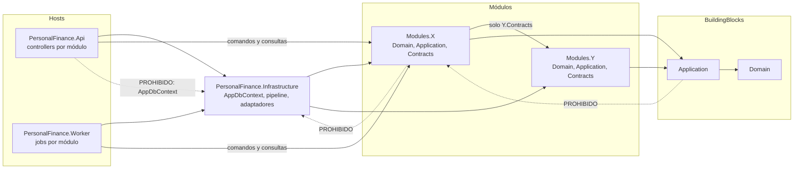

# Dependencias entre proyectos

`Infrastructure` referencia a todos los módulos porque implementa lo que piden (persistencia, auditoría, adaptadores). Es una capa exterior: ningún módulo ni BuildingBlock la referencia.

La flecha entre módulos es una referencia de proyecto completa; que solo se use el namespace `Contracts` lo comprueban los tests de arquitectura.
