# Diagrama entidad-relación

## M. ERD completo

Línea continua: FK declarada dentro del esquema. Línea punteada: referencia por id entre módulos, sin FK. Se muestran las columnas que definen claves, relaciones, estado y dinero.

```mermaid
erDiagram
    USERS ||--|| USER_PREFERENCES : tiene
    USERS ||..o{ MEMBERSHIPS : "participa en"
    WORKSPACES ||--o{ MEMBERSHIPS : contiene
    WORKSPACES ||--o{ INVITATIONS : emite

    USERS ||..o{ NOTIFICATIONS : recibe
    NOTIFICATIONS ||--o{ DELIVERIES : "se entrega por"
    USERS ||..o{ NOTIFICATION_PREFERENCES : configura
    USERS ||..o{ CHANNEL_ENDPOINTS : verifica

    CATEGORIES ||--o{ CATEGORIES : "es padre de"
    CATEGORIES ||--o{ CATEGORY_TAGS : sugiere
    TAGS ||--o{ CATEGORY_TAGS : "se sugiere en"

    ACCOUNTS ||--o| CREDIT_CARD_PROFILES : "perfil de tarjeta"
    ACCOUNTS ||--o{ ENTRIES : registra
    OPERATIONS ||--|{ ENTRIES : "se compone de"
    OPERATIONS ||--o{ OPERATION_TAGS : etiquetada
    TAGS ||..o{ OPERATION_TAGS : etiqueta
    CATEGORIES ||..o{ OPERATIONS : clasifica
    OPERATIONS ||--o| INSTALLMENT_PLANS : "se paga en cuotas"
    INSTALLMENT_PLANS ||--o{ INSTALLMENT_CHARGES : genera

    RECURRING_RULES ||--o{ OCCURRENCES : produce
    OCCURRENCES |o..o| OPERATIONS : registra
    ACCOUNTS ||..o{ RECURRING_RULES : "plantilla sobre"

    CATEGORIES ||..o{ BUDGETS : limita
    BUDGETS ||--o{ BUDGET_ALERTS : emitio

    GOALS ||--|{ GOAL_PARTICIPANTS : tiene
    USERS ||..o{ GOAL_PARTICIPANTS : es
    GOALS ||--o{ GOAL_CONTRIBUTIONS : recibe
    GOAL_PARTICIPANTS ||--o{ GOAL_CONTRIBUTIONS : aporta
    GOAL_CONTRIBUTIONS ||..|| OPERATIONS : "movimiento de"
    GOAL_PARTICIPANTS |o..o| ACCOUNTS : "destino del aporte"

    SHARED_GROUPS ||--|{ GROUP_MEMBERS : tiene
    USERS ||..o{ GROUP_MEMBERS : es
    SHARED_GROUPS ||--o{ SHARED_EXPENSES : agrupa
    GROUP_MEMBERS ||--o{ SHARED_EXPENSES : pago
    SHARED_EXPENSES ||--|{ EXPENSE_SHARES : "se reparte en"
    GROUP_MEMBERS ||--o{ EXPENSE_SHARES : debe
    SHARED_GROUPS ||--o{ SETTLEMENTS : liquida
    SETTLEMENTS ||--|{ SETTLEMENT_ALLOCATIONS : cubre
    EXPENSE_SHARES ||--o{ SETTLEMENT_ALLOCATIONS : "se cubre con"
    SHARED_EXPENSES |o..o| OPERATIONS : "pago del pagador"
    SETTLEMENTS |o..o| OPERATIONS : "lado deudor y acreedor"

    IMPORT_SESSIONS ||--o{ IMPORT_RECORDS : contiene
    IMPORT_RECORDS |o..o| OPERATIONS : confirma
    CATEGORIES ||..o{ CATEGORIZATION_RULES : "destino de"

    ASSETS ||--o{ HOLDINGS : "posicion en"
    HOLDINGS ||--o{ INVESTMENT_TRANSACTIONS : registra
    ASSETS ||--o{ PRICE_SNAPSHOTS : cotiza
    HOLDINGS ||--o{ HOLDING_VALUATIONS : valua
    HOLDINGS |o..|| ACCOUNTS : "cuenta de inversion"
    INVESTMENT_TRANSACTIONS |o..o| OPERATIONS : "movimiento de efectivo"

    USERS {
        uuid id PK
        text email UK
        text display_name
        text phone
        text status
        timestamptz created_at
    }
    USER_PREFERENCES {
        uuid user_id PK, FK
        text locale
        text date_format
        text week_start
        boolean hide_balances
        uuid default_workspace_id
        smallint savings_rate_target
    }
    WORKSPACES {
        uuid id PK
        text name
        char3 base_currency
        text time_zone
        text status
        uuid owner_user_id
    }
    MEMBERSHIPS {
        uuid id PK
        uuid workspace_id FK
        uuid user_id
        text role
        text status
        timestamptz joined_at
    }
    INVITATIONS {
        uuid id PK
        uuid workspace_id FK
        text email
        text role
        text token_hash UK
        text status
        timestamptz expires_at
    }
    NOTIFICATIONS {
        uuid id PK
        uuid user_id
        uuid workspace_id
        text category
        text type
        text severity
        text title
        text deep_link
        text dedupe_key
        timestamptz read_at
    }
    NOTIFICATION_PREFERENCES {
        uuid user_id PK
        text category PK
        text channel PK
        boolean enabled
    }
    CHANNEL_ENDPOINTS {
        uuid id PK
        uuid user_id
        text channel
        text address
        timestamptz verified_at
    }
    DELIVERIES {
        uuid id PK
        uuid notification_id FK
        text channel
        text status
        int attempts
        text provider_message_id
    }
    CATEGORIES {
        uuid id PK
        uuid workspace_id
        uuid owner_user_id
        uuid parent_id FK
        text kind
        text name
        text system_key
        timestamptz archived_at
    }
    TAGS {
        uuid id PK
        uuid workspace_id
        uuid owner_user_id
        text name
    }
    CATEGORY_TAGS {
        uuid category_id PK, FK
        uuid tag_id PK, FK
    }
    ACCOUNTS {
        uuid id PK
        uuid workspace_id
        uuid owner_user_id
        text name
        text type
        char3 currency
        boolean is_system
        boolean is_favorite
        text linked_resource_type
        uuid linked_resource_id
        text status
    }
    CREDIT_CARD_PROFILES {
        uuid account_id PK, FK
        numeric credit_limit
        smallint statement_closing_day
        smallint payment_due_day
    }
    OPERATIONS {
        uuid id PK
        uuid workspace_id
        uuid owner_user_id
        text kind
        text status
        date occurred_on
        text description
        text payee
        uuid category_id
        text origin
        text source_module
        text source_type
        uuid source_id
        timestamptz voided_at
    }
    ENTRIES {
        uuid id PK
        uuid operation_id FK
        uuid account_id FK
        text direction
        numeric amount
        char3 currency
        numeric signed_amount
        numeric base_amount
        numeric fx_rate
        boolean is_effective
        date occurred_on
    }
    OPERATION_TAGS {
        uuid operation_id PK, FK
        uuid tag_id PK
    }
    INSTALLMENT_PLANS {
        uuid id PK
        uuid purchase_operation_id FK
        uuid account_id FK
        numeric principal
        smallint months
        numeric monthly_rate_percent
        text status
    }
    INSTALLMENT_CHARGES {
        uuid plan_id PK, FK
        smallint number PK
        uuid operation_id FK
    }
    RECURRING_RULES {
        uuid id PK
        uuid workspace_id
        uuid owner_user_id
        text kind
        uuid account_id
        uuid destination_account_id
        uuid category_id
        numeric amount
        char3 currency
        text frequency
        date start_date
        date end_date
        text posting_mode
        smallint reminder_offset_days
        text status
    }
    OCCURRENCES {
        uuid id PK
        uuid rule_id FK
        date scheduled_date
        text status
        uuid ledger_operation_id
    }
    BUDGETS {
        uuid id PK
        uuid workspace_id
        uuid owner_user_id
        uuid category_id
        text period_type
        numeric amount
        char3 currency
        smallint alert_threshold_percent
        boolean rollover
        boolean is_fixed
        date effective_from
        date ends_on
    }
    BUDGET_ALERTS {
        uuid budget_id PK, FK
        date period_start PK
        smallint threshold PK
        timestamptz notified_at
    }
    GOALS {
        uuid id PK
        uuid workspace_id
        uuid created_by_user_id
        text name
        numeric target_amount
        char3 currency
        date target_date
        text status
    }
    GOAL_PARTICIPANTS {
        uuid id PK
        uuid goal_id FK
        uuid user_id
        text role
        text status
        uuid linked_account_id
        uuid fund_account_id
    }
    GOAL_CONTRIBUTIONS {
        uuid id PK
        uuid goal_id FK
        uuid participant_id FK
        text type
        numeric amount
        char3 currency
        date occurred_on
        uuid ledger_operation_id UK
        text status
    }
    SHARED_GROUPS {
        uuid id PK
        uuid workspace_id
        text name
        char3 currency
        text status
        uuid created_by_user_id
    }
    GROUP_MEMBERS {
        uuid id PK
        uuid group_id FK
        uuid user_id
        text display_name
        text role
        text status
    }
    SHARED_EXPENSES {
        uuid id PK
        uuid group_id FK
        uuid paid_by_member_id FK
        text description
        numeric total_amount
        char3 currency
        date occurred_on
        text split_type
        text status
        uuid payer_operation_id
    }
    EXPENSE_SHARES {
        uuid id PK
        uuid expense_id FK
        uuid member_id FK
        numeric split_value
        numeric amount
        numeric paid_amount
    }
    SETTLEMENTS {
        uuid id PK
        uuid group_id FK
        uuid from_member_id FK
        uuid to_member_id FK
        numeric amount
        char3 currency
        date occurred_on
        text method
        text status
        uuid payer_operation_id
        uuid payee_operation_id
    }
    SETTLEMENT_ALLOCATIONS {
        uuid settlement_id PK, FK
        uuid share_id PK, FK
        numeric amount
    }
    IMPORT_SESSIONS {
        uuid id PK
        uuid workspace_id
        uuid owner_user_id
        text source_format
        text file_hash
        uuid target_account_id
        text status
    }
    IMPORT_RECORDS {
        uuid id PK
        uuid session_id FK
        int line_number
        text fingerprint
        date occurred_on
        numeric amount
        text status
        uuid ledger_operation_id
    }
    CATEGORIZATION_RULES {
        uuid id PK
        uuid workspace_id
        uuid owner_user_id
        text pattern
        uuid category_id
        boolean enabled
        int priority
    }
    ASSETS {
        uuid id PK
        uuid owner_user_id
        text symbol
        text name
        text type
        char3 currency
    }
    HOLDINGS {
        uuid id PK
        uuid workspace_id
        uuid owner_user_id
        uuid asset_id FK
        text institution
        uuid ledger_account_id
        numeric tea_percent
        date maturity_date
        text status
    }
    INVESTMENT_TRANSACTIONS {
        uuid id PK
        uuid holding_id FK
        text type
        numeric quantity
        numeric unit_price
        numeric amount
        date occurred_on
        uuid ledger_operation_id
    }
    PRICE_SNAPSHOTS {
        uuid asset_id PK, FK
        date as_of PK
        text source PK
        numeric price
    }
    HOLDING_VALUATIONS {
        uuid holding_id PK, FK
        date as_of PK
        numeric value
    }
```

### M.1 Explicación

**Identidad y pertenencia.** `USERS 1:N MEMBERSHIPS N:1 WORKSPACES` es la relación del encargo y es adecuada. La membresía lleva rol y estado; expulsar no borra la fila. Un índice único parcial asegura un solo Owner activo. La invitación es una entidad aparte porque existe antes de que haya usuario.

**Propiedad.** Cada raíz privada lleva `workspace_id` y `owner_user_id`. `ENTRIES` los repite a propósito para que las sumas de saldo filtren sin unir con `OPERATIONS`. Las tablas colaborativas no tienen dueño: el acceso lo dan `GOAL_PARTICIPANTS` y `GROUP_MEMBERS`.

**Ledger.** `OPERATIONS 1:N ENTRIES`, con al menos un asiento. Una transferencia tiene dos. `ENTRIES N:1 ACCOUNTS`. No hay tabla `transfers` ni columna de saldo. `CREDIT_CARD_PROFILES` es 0..1 por cuenta. La categoría es una referencia blanda porque pertenece a otro módulo; no puede quedar colgando porque las categorías no se borran.

**Enlaces con el ledger.** `GOAL_CONTRIBUTIONS`, `SETTLEMENTS`, `SHARED_EXPENSES`, `OCCURRENCES`, `IMPORT_RECORDS` e `INVESTMENT_TRANSACTIONS` guardan el id de la operación que generaron, con índice único para que una operación no respalde dos hechos. En sentido inverso, `OPERATIONS.source_*` apunta al hecho de origen; su índice único es la idempotencia entre módulos.

**Metas.** `GOALS 1:N GOAL_PARTICIPANTS` con al menos uno. El participante guarda a qué cuenta suya van sus aportes: una cuenta de ahorro vinculada o un fondo de sistema. `GOAL_CONTRIBUTIONS` pertenece a la meta y a un participante y lleva monto propio (K.1).

**Gastos compartidos.** `SHARED_GROUPS 1:N SHARED_EXPENSES 1:N EXPENSE_SHARES`. `paid_amount` lo mantiene el agregado y está acotado por un CHECK. Una liquidación cubre una o varias partes mediante `SETTLEMENT_ALLOCATIONS`; eso permite pagar una parte concreta o liquidar varias de una vez. Cada lado enlaza su propia operación. `GROUP_MEMBERS.user_id` admite nulo para invitados futuros (OQ-08).

**Scheduling.** Las ocurrencias futuras no se guardan; solo las resueltas, únicas por regla y fecha.

**Presupuestos.** Versionados por `effective_from` y `ends_on`. No hay tabla de consumo.

**Inversiones.** `ASSETS` puede ser global o propio. `HOLDINGS` enlaza la cuenta de sistema que refleja el capital aportado. El valor de mercado sale de `PRICE_SNAPSHOTS` o de `HOLDING_VALUATIONS`.

**`platform`.** Sus seis tablas no aparecen en el diagrama porque no se relacionan con ninguna otra; están descritas en L.2.
