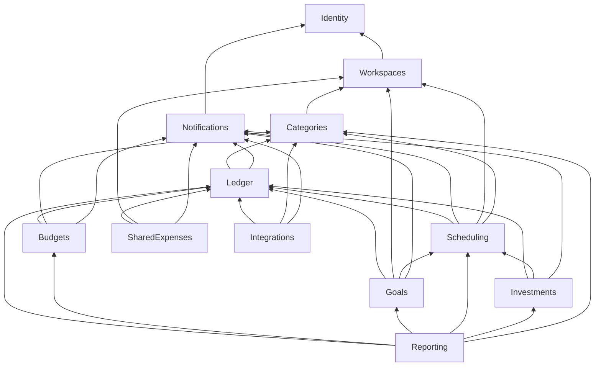

# Módulos

Una flecha significa "usa el `Contracts` de": para llamarlo o para reaccionar a uno de sus eventos. Tres flechas existen solo por eventos: `Categories → Workspaces` (sembrar categorías al completar el onboarding o al unirse un miembro), `Scheduling → Workspaces` (pausar reglas de un miembro expulsado) y `Scheduling → Categories` (avisar de reglas con una categoría archivada).

Este grafo es el que declara `ModuleBoundaryTests.AllowedDependencies`.
