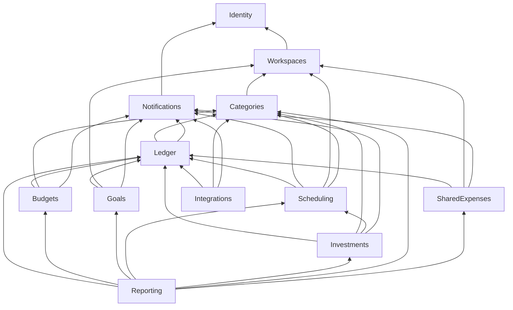

# Módulos

Una flecha significa "usa el `Contracts` de": para llamarlo o para reaccionar a uno de sus eventos. Una flecha existe solo por un evento: `Categories → Workspaces` (sembrar categorías al completar el onboarding o al unirse un miembro). `Scheduling → Workspaces` sirve para recorrer los espacios en el ciclo del Worker, y `Scheduling → Categories` para leer y validar la categoría de una regla. Que Scheduling pause las reglas de un miembro expulsado, o avise de reglas con una categoría archivada, sigue pendiente ([status.md](../roadmap/status.md), fase 7).

Este grafo es el que declara `ModuleBoundaryTests.AllowedDependencies`.
