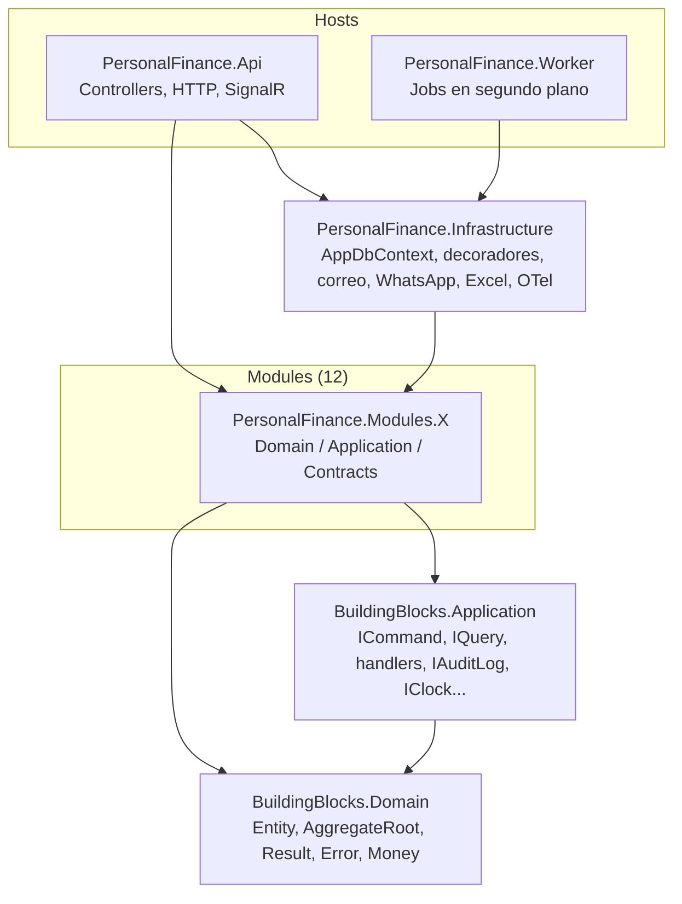
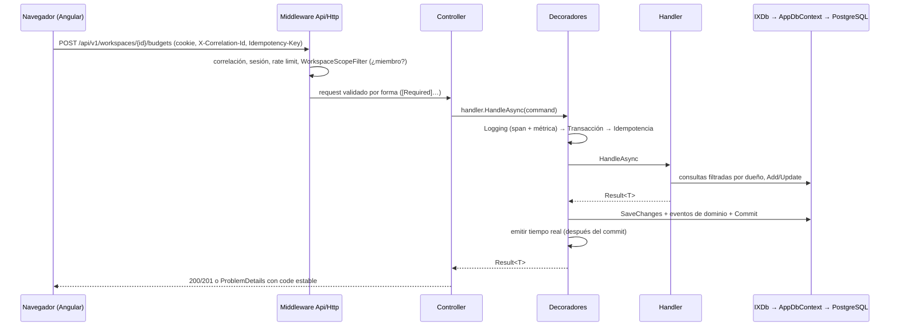

# Guía técnica para quien se incorpora

Este documento reúne en un solo sitio lo que necesitas para cambiar PersonalHub sin romper nada: tecnologías, paquetes, arquitectura, cómo se comunican los proyectos, base de datos, configuración y el flujo para añadir una feature. Cada sección enlaza al documento que la explica a fondo; no hace falta leerlos todos el primer día.

Antes de tocar código lee también [AGENTS.md](../../AGENTS.md): son las reglas que no se negocian y aquí se explican, no se repiten.

---

## 1. Qué es y cómo está organizado el repositorio

PersonalHub es una aplicación de finanzas personales y colaborativas para unos 10 usuarios, mantenida por una sola persona. Por eso **se prefiere lo simple**: un único proceso de API, un único Worker, una sola base de datos y nada de infraestructura que no haga falta ([ADR-019](../adr/ADR-019-simplificacion-de-la-plataforma.md)).

```text
PersonalHubV2/                      repositorio git principal
  AGENTS.md                         reglas para personas y agentes
  docs/                             documentación (backend y frontend)
  finanzas-hub-api/                 backend .NET 10
  finanzas-hub-web/                 frontend Angular 22 — repositorio git propio, anidado
  Mocks_finanzas-hub-angular/       mocks visuales de referencia (origen de los tokens de diseño)
```

`finanzas-hub-web` tiene su propio `.git`: los cambios del frontend se confirman allí, y los del backend y la documentación en el repositorio principal. Cada fase se cierra con un commit en cada uno.

---

## 2. Tecnologías

| Capa | Tecnología | Versión | Notas |
|---|---|---|---|
| Backend | .NET / C# | 10 (`net10.0`, `LangVersion latest`) | Nullable activado y **warnings como errores** |
| API | ASP.NET Core con Controllers | 10 | No Minimal APIs dentro de los módulos |
| Tiempo real | SignalR | 10 | Hub en `/hubs/realtime` |
| ORM | Entity Framework Core + Npgsql | 10 | Un solo `AppDbContext` |
| Base de datos | PostgreSQL | 17 | Un esquema por módulo |
| Autenticación | ASP.NET Core Identity + cookie de sesión | 10 | Sin JWT ([ADR-015](../adr/ADR-015-autenticacion.md), [ADR-020](../adr/ADR-020-sesion-y-correos.md)) |
| Observabilidad | OpenTelemetry (OTLP) + Aspire Dashboard | 1.19 | Trazas, métricas y logs |
| Documentación de API | OpenAPI (`Microsoft.AspNetCore.OpenApi`) + Scalar | — | Scalar en `/scalar` fuera de Production |
| Frontend | Angular, sin zonas, standalone, signals | 22 | TypeScript 6 |
| Tests backend | xUnit, Testcontainers, NetArchTest | — | Ver §10 |
| Tests frontend | Vitest + jsdom, Playwright (E2E) | 5 / 1.64 | |
| Correo local | Mailpit | — | Bandeja en http://localhost:8025 |
| CI/CD | Jenkins (servidor Mercury) + SonarQube + Docker | — | Ver §12 |

---

## 3. Paquetes NuGet

Las versiones se fijan **una sola vez** en [`finanzas-hub-api/Directory.Packages.props`](../../finanzas-hub-api/Directory.Packages.props) (Central Package Management). En un `.csproj` el paquete se referencia **sin versión**:

```xml
<PackageReference Include="Microsoft.EntityFrameworkCore" />
```

| Paquete | Versión | Lo usa | Para qué |
|---|---|---|---|
| `Microsoft.EntityFrameworkCore` | 10.0.12 | Módulos, Infrastructure | `DbSet` en las interfaces `IXDb` y consultas LINQ |
| `Microsoft.EntityFrameworkCore.Relational` | 10.0.12 | Infrastructure | Mapeos relacionales, transacciones |
| `Microsoft.EntityFrameworkCore.Design` | 10.0.12 | Api, Infrastructure | Herramienta `dotnet-ef` (migraciones) |
| `Npgsql.EntityFrameworkCore.PostgreSQL` | 10.0.3 | Infrastructure | Proveedor PostgreSQL |
| `EFCore.NamingConventions` | 10.0.1 | Infrastructure | Tablas y columnas en `snake_case` |
| `Microsoft.Extensions.Identity.Stores` | 10.0.12 | Identity | `IdentityUser`, hashing, lockout |
| `Microsoft.AspNetCore.Identity.EntityFrameworkCore` | 10.0.12 | Infrastructure | Store de Identity sobre `AppDbContext` |
| `Microsoft.AspNetCore.DataProtection.EntityFrameworkCore` | 10.0.12 | Infrastructure | Claves de cookies y tokens guardadas en la base (un redespliegue no cierra sesiones) |
| `ClosedXML` | 0.105.0 | Infrastructure | Leer Excel de bancos y exportar reportes a `.xlsx` |
| `Microsoft.AspNetCore.OpenApi` | 10.0.12 | Api | Genera `openapi/v1.json` |
| `Scalar.AspNetCore` | 2.18.0 | Api | Explorador interactivo de la API |
| `Microsoft.Extensions.Hosting` | 10.0.12 | Worker | Host genérico de los jobs |
| `OpenTelemetry.Extensions.Hosting` | 1.19.1 | Infrastructure | Registro de OpenTelemetry |
| `OpenTelemetry.Exporter.OpenTelemetryProtocol` | 1.19.1 | Infrastructure | Exportador OTLP |
| `OpenTelemetry.Instrumentation.AspNetCore` | 1.19.0 | Infrastructure | Spans de peticiones HTTP |
| `OpenTelemetry.Instrumentation.Http` | 1.19.0 | Infrastructure | Spans de llamadas salientes (WhatsApp) |
| `Npgsql.OpenTelemetry` | 10.0.3 | Infrastructure | Spans de SQL |
| `xunit`, `xunit.runner.visualstudio`, `Microsoft.NET.Test.Sdk` | 2.9.3 / 3.1.5 / 18.10.1 | Tests | Framework de tests |
| `Microsoft.AspNetCore.Mvc.Testing` | 10.0.12 | IntegrationTests | API real en memoria (`WebApplicationFactory`) |
| `Testcontainers.PostgreSql` | 4.16.0 | IntegrationTests | PostgreSQL desechable en Docker |
| `NetArchTest.Rules` | 1.3.2 | ArchitectureTests | Reglas de dependencias entre capas y módulos |

Herramienta local: `dotnet-ef` 10.0.12 en [`dotnet-tools.json`](../../finanzas-hub-api/dotnet-tools.json); los scripts de `tools/` hacen `dotnet tool restore` por ti.

**Lo que no se añade sin un ADR:** MediatR, AutoMapper, repositorios o unidades de trabajo genéricos, Redis, colas externas, Hangfire, Quartz. Tampoco FluentValidation ni librerías que dupliquen lo que ya hace la plataforma. Si crees que hace falta un paquete nuevo, abre primero un ADR en [docs/adr/](../adr/README.md).

### Paquetes npm del frontend

| Paquete | Para qué |
|---|---|
| `@angular/*` 22 | Framework (common, core, forms, router, platform-browser) |
| `@microsoft/signalr` 8 | Cliente del hub de tiempo real |
| `rxjs` 7.8 | Solo donde Angular lo exige (`HttpClient`); el estado va en signals |
| `vitest`, `jsdom` | Tests unitarios |
| `@playwright/test` | Tests E2E |
| `eslint`, `angular-eslint`, `typescript-eslint`, `eslint-plugin-boundaries` | Lint y fronteras entre carpetas |
| `prettier` | Formato |
| `openapi-typescript` 7.13 (vía `npx`) | Genera `core/api/schema.ts` desde el contrato |

No se usa NgRx, ni librerías de componentes, ni de gráficos: los componentes y las gráficas son propios.

---

## 4. Arquitectura

**Monolito modular** ([ADR-001](../adr/ADR-001-monolito-modular.md)): un solo despliegue, dividido en módulos de negocio con fronteras estrictas que verifican los tests de arquitectura.

### 4.1 Proyectos de la solución (`PersonalFinance.slnx`)



| Proyecto | Responsabilidad | Puede referenciar |
|---|---|---|
| `BuildingBlocks.Domain` | Tipos base: `Entity`, `AggregateRoot`, `IDomainEvent`, `IOwned`, `Result`, `Error`, `Money`, `Currency`, `DateRange` | Nada |
| `BuildingBlocks.Application` | Contratos de la aplicación: `ICommand`, `IQuery`, sus handlers, `IIdempotentCommand`, `IDomainEventHandler`, `ICurrentUser`, `IWorkspaceContext`, `IAuditLog`, `IClock`, `IEmailSender`, `IRealtimeNotifier`, `ISpreadsheets` | `BuildingBlocks.Domain` |
| `Modules.X` (12) | Negocio de un área. Carpetas `Domain`, `Application`, `Contracts` | Los BuildingBlocks y el `Contracts` de los módulos que permite el grafo |
| `Infrastructure` | Implementa lo que la aplicación pide: `AppDbContext`, migraciones, decoradores, auditoría, correo SMTP, WhatsApp, ClosedXML, OpenTelemetry, contexto del actor | BuildingBlocks y todos los módulos |
| `Api` | Entrada HTTP: controllers, sesión, CORS, rate limiting, ProblemDetails, hub SignalR | Infrastructure y módulos (solo para nombrar comandos/consultas) |
| `Worker` | Entrada sin HTTP: jobs periódicos | Infrastructure |

### 4.2 Capas dentro de un módulo

```text
Modules/Budgets/PersonalFinance.Modules.Budgets/
  Domain/            Budget.cs, BudgetProgress.cs        reglas e invariantes; sin EF, sin ASP.NET
  Application/
    Abstractions/    IBudgetsDb.cs                       los DbSet que el módulo puede ver
    Budgets.cs       comandos, consultas, respuestas y handlers de un área
    BudgetAlerts.cs  reacción al evento LedgerOperationChanged
  Contracts/         BudgetContracts.cs                  lo único que otro módulo puede usar
```

- `Domain` solo depende de `BuildingBlocks.Domain`.
- `Application` no depende de `Infrastructure`, de Npgsql ni de ASP.NET.
- Comandos, consultas, respuestas, entidades e `IXDb` son `public`; handlers e implementaciones son `internal`.

### 4.3 Los 12 módulos

| Módulo | Esquema PostgreSQL | Qué hace | Doc |
|---|---|---|---|
| Identity | `identity` | Cuentas, sesión, perfil, preferencias | [identity.md](../modules/identity.md) |
| Workspaces | `workspaces` | Workspaces, miembros, roles, invitaciones | [workspaces.md](../modules/workspaces.md) |
| Notifications | `notifications` | Bandeja de avisos, cola de envíos (correo/WhatsApp), tiempo real | [notifications.md](../modules/notifications.md) |
| Categories | `categories` | Categorías, subcategorías y tags privados | [categories.md](../modules/categories.md) |
| Ledger | `ledger` | Cuentas, operaciones, asientos, transferencias, tarjetas, tipo de cambio. **Única fuente de saldos** | [ledger.md](../modules/ledger.md) |
| Budgets | `budgets` | Presupuestos mensuales por categoría | [budgets.md](../modules/budgets.md) |
| Scheduling | `scheduling` | Movimientos programados y calendario | [scheduling.md](../modules/scheduling.md) |
| Goals | `goals` | Metas personales y compartidas | [goals.md](../modules/goals.md) |
| SharedExpenses | `shared_expenses` | Gastos compartidos entre miembros | [shared-expenses.md](../modules/shared-expenses.md) |
| Integrations | `integrations` | Importación de bancos y Bluecoins, reglas, WhatsApp | [integrations.md](../modules/integrations.md) |
| Investments | `investments` | Inversiones, depósitos a plazo, valorización | [investments.md](../modules/investments.md) |
| Reporting | — (sin tablas) | Inicio, reportes, exportación, búsqueda global; lee los `Contracts` de otros | [reporting.md](../modules/reporting.md) |

Además, el esquema `platform` guarda lo transversal: idempotencia, auditoría, cola de correos, claves de Data Protection e historial de migraciones.

El grafo de qué módulo puede usar a cuál está en [diagrams/modules.md](../diagrams/modules.md) y lo hace cumplir `ModuleBoundaryTests.AllowedDependencies`.

---

## 5. Cómo se comunican los proyectos

### 5.1 Una petición HTTP de principio a fin



1. **Middleware** (`Api/Http`): correlación, sesión por cookie, CORS, comprobación de origen, rate limiting y `WorkspaceScopeFilter`, que valida que la persona es miembro del workspace de la ruta e inicializa el `ActorContext`.
2. **Controller** (`Api/Controllers/<Módulo>`): valida la forma del request, arma el comando o la consulta, pide el handler por `[FromServices]` y convierte el `Result` con `ToActionResult`. No tiene reglas de negocio ni toca la base.
3. **Decoradores** (`Infrastructure/Messaging/HandlerDecorators.cs`), registrados automáticamente:
   - `Logging…Decorator`: span `Módulo.CasoDeUso`, log y métrica de duración.
   - `TransactionCommandHandlerDecorator`: abre la transacción, ejecuta el handler, guarda, despacha eventos de dominio y hace commit. Si el `Result` es fallo o una reacción lanza, revierte todo.
   - `IdempotencyCommandHandlerDecorator`: solo para comandos `IIdempotentCommand`; un reintento con la misma clave devuelve la primera respuesta.
4. **Handler** (`Modules.X/Application`): el caso de uso. Devuelve `Result<T>` y nunca llama a `SaveChanges`.
5. **Errores**: `Error.Validation → 400`, `Unauthorized → 401`, `Forbidden → 403`, `NotFound → 404`, `Conflict → 409`, `BusinessRule → 422`, siempre como `ProblemDetails` con un `code` estable ([backend/api-conventions.md](../backend/api-conventions.md), [ADR-011](../adr/ADR-011-errores.md)).

### 5.2 Entre módulos

Dos únicas vías ([module-communication.md](../backend/module-communication.md)):

| Vía | Cuándo | Cómo |
|---|---|---|
| **Llamada síncrona a un contrato** | Un módulo necesita leer o pedir algo a otro | Interfaz en `Modules.Y/Contracts` (p. ej. `ILedgerQueries`, `ICategoryLookup`), implementada por una clase `internal` de `Modules.Y/Application`. `AddModule` la registra sola |
| **Evento de dominio** | Otro módulo debe reaccionar a algo que pasó | Evento `record ... : IDomainEvent` en `Modules.Y/Contracts/Events`; un `IDomainEventHandler<TEvento>` en el módulo que reacciona |

Los eventos se entregan **en proceso y dentro de la transacción** del comando: si la reacción falla, el comando se revierte. Una reacción **nunca** llama a nada externo (correo, WhatsApp, HTTP); para eso escribe en la cola de envíos, que procesa un job del Worker. Ejemplo real: `Ledger` publica `LedgerOperationChanged` y `Budgets.BudgetAlerts` reacciona para avisar cuando un presupuesto se acerca al límite.

Entre módulos solo se guarda el **id** del otro (`CategoryId`), nunca una propiedad de navegación de EF.

### 5.3 API ↔ Worker

No se hablan directamente. Comparten base de datos y código (`AddInfrastructure`):

- La API **encola** (fila en `platform.outgoing_emails` o en la cola de envíos de `notifications`).
- El Worker la **procesa** con jobs periódicos (`Jobs/<Módulo>`, base `PeriodicJob`): `SendEmailsJob`, `SendWhatsAppJob`, `RunDueOccurrencesJob` (movimientos programados) y `PurgeExpiredIdempotencyKeysJob`.
- Si el Worker está parado, lo encolado espera; no se pierde.

### 5.4 Frontend ↔ API

- **HTTP con rutas relativas** (`/api/v1/...`). En local, [`proxy.conf.json`](../../finanzas-hub-web/proxy.conf.json) reenvía `/api`, `/health`, `/openapi` y `/hubs` a `http://localhost:5166`. En despliegue lo hace el nginx de la imagen del frontend. Así navegador y API comparten origen y la cookie de sesión funciona sin CORS.
- **Interceptores** (`core/http/api-interceptors.ts`): envían credenciales, añaden `X-Correlation-Id`, generan `Idempotency-Key` en los comandos que lo necesitan y traducen `ProblemDetails` a errores tipados.
- **Tipos generados**: `docs/api/openapi.v1.json` → `npm run api:generate` → `core/api/schema.ts`; `core/api/api-types.ts` solo les da nombres cortos. Nunca se escribe un tipo de la API a mano.
- **Tiempo real**: SignalR en `/hubs/realtime`. Los handlers publican con `IRealtimeNotifier`; se emite solo después del commit.

### 5.5 Servicios externos

| Servicio | Quién lo llama | Cómo |
|---|---|---|
| SMTP (Mailpit en local) | Worker, `SendEmailsJob` | `EmailDispatcher`. Sin `Email:SmtpHost` escribe `.eml` en disco |
| WhatsApp Cloud API (Meta Graph) | Worker, `SendWhatsAppJob`; el webhook entra por la API | `WhatsAppSender` con `HttpClient`; firma del webhook verificada con `AppSecret` |
| Collector OTLP (Aspire Dashboard en local) | API y Worker | `OTEL_EXPORTER_OTLP_ENDPOINT` |

---

## 6. Patrones de diseño

Resumen. Cada patrón explicado con su código: [backend/patterns.md](../backend/patterns.md) y [frontend/patterns.md](../frontend/patterns.md). Cómo se evitan las carreras y los duplicados: [backend/concurrency.md](../backend/concurrency.md).

| Patrón | Dónde | Por qué |
|---|---|---|
| **Monolito modular** | Toda la solución | Fronteras claras sin coste de microservicios ([ADR-001](../adr/ADR-001-monolito-modular.md)) |
| **CQRS ligero** (comando/consulta + handler) | `ICommand`, `IQuery`, `ICommandHandler`, `IQueryHandler` | Un caso de uso = una clase. Sin MediatR: el controller recibe el handler por DI |
| **Decorator** | Logging, transacción, idempotencia | Lo transversal se aplica a todos los handlers sin que estos lo sepan |
| **Result pattern** | `Result<T>`, `Error` | Las reglas de negocio no lanzan excepciones; el error es parte del contrato |
| **Modelo de dominio rico / Aggregate root** | `Domain/` de cada módulo (`Budget.Create`, `budget.Adjust`) | Invariantes dentro de la entidad; constructores privados y fábricas que devuelven `Result` |
| **Domain events** en proceso | `IDomainEvent`, `IDomainEventHandler`, `DomainEventDispatcher` | Reacciones entre módulos con consistencia transaccional ([ADR-006](../adr/ADR-006-eventos.md)) |
| **Contracts como fachada** | `Modules.X/Contracts` | Lo que un módulo expone a otros; el resto es interno |
| **Interfaz de persistencia por módulo** | `IXDb` implementada por `AppDbContext` | Un módulo solo ve sus tablas, sin repositorios genéricos ([ADR-003](../adr/ADR-003-persistencia.md)) |
| **Filtro global por dueño** | `IOwned` + `HasQueryFilter` en `AppDbContext` | Privacidad por defecto: lo de otra persona ni siquiera se consulta, y responde 404 ([ADR-021](../adr/ADR-021-finanzas-privadas-de-la-persona.md)) |
| **Ledger de doble entrada** | Módulo Ledger | El saldo se deriva de los asientos; nada se borra, se anula ([ADR-004](../adr/ADR-004-ledger-financiero.md)) |
| **Idempotency key** | `IIdempotentCommand` + cabecera `Idempotency-Key` | Un reintento no duplica dinero ([ADR-016](../adr/ADR-016-idempotencia-y-concurrencia.md)) |
| **Concurrencia optimista** | `xmin` como token en los agregados | Dos escrituras simultáneas sobre la misma fila no se pisan: la segunda responde 409. `ETag`/`If-Match` no está implementado ([concurrency.md](../backend/concurrency.md)) |
| **Cola en tabla** | Correos y envíos | Lo externo sale por un job, fuera de la transacción ([ADR-018](../adr/ADR-018-notificaciones.md)) |
| **Template method** | `PeriodicJob` | Cada job solo define `Interval` y `RunAsync` |
| **Registro por escaneo de ensamblado** | `AddModule` | Añadir un handler no requiere registrarlo a mano |
| **Options pattern** | `EmailOptions`, `FrontendOptions`, `WhatsAppOptions` | Configuración tipada desde `appsettings`/entorno |
| **Auditoría funcional** | `IAuditLog.Record(...)` | Cada acción de negocio queda registrada ([ADR-017](../adr/ADR-017-auditoria-funcional.md)) |

En el frontend: **stores con signals** en `core` (`SessionStore`, `WorkspaceStore`, `PeriodStore`, `ThemeStore`), **`httpResource`** para leer, servicios `*-api.ts` por feature para escribir, **interceptores funcionales**, componentes standalone `OnPush`, Signal Forms y la regla de que **una feature no importa a otra** ([frontend/architecture.md](../frontend/architecture.md), [ADR-010](../adr/ADR-010-estado-en-el-frontend.md)).

---

## 7. Base de datos

- **PostgreSQL 17**. En local con `docker compose` o instalado en la máquina.
- **Un solo `AppDbContext`** (`Infrastructure/Persistence/AppDbContext.cs`, `internal`). Implementa todas las `IXDb`.
- **Un esquema por módulo** (tabla de §4.3) más `platform`. Constantes en `Schemas`.
- **Nombres en `snake_case`** automáticos (`EFCore.NamingConventions`).
- **Ids** `Guid` v7 generados por la aplicación (`Entity.NewId()`).
- **Mapeos** en `Infrastructure/Persistence/Configurations/<Módulo>/`, nunca con atributos en el dominio.
- **Migraciones** en `Infrastructure/Persistence/Migrations/`, historial en `platform.__ef_migrations_history`.
- **Dinero**: `decimal` con moneda explícita; no hay columna de saldo; nada financiero se borra ([ledger.md](../backend/ledger.md)).

```powershell
# desde finanzas-hub-api
tools/add-migration.ps1 -Name AddAlgo      # crea la migración (necesita la cadena de conexión configurada)
tools/migrate.ps1                          # aplica las pendientes
```

En Development la API aplica las migraciones al arrancar (`Database:MigrateOnStartup`). En despliegue se aplican **antes** de cambiar los contenedores con `docker run <imagen> migrate`; si fallan, no se despliega. Revisa siempre el SQL generado y lee [migrations.md](../backend/migrations.md) y [data-model.md](../backend/data-model.md).

**La referencia completa está en [backend/database.md](../backend/database.md)**: las 47 tablas con sus columnas, claves, índices, restricciones `CHECK`, claves foráneas y un diagrama ER por esquema. Su parte de referencia se genera desde el snapshot de EF: después de cada migración, `node tools/update-db-docs.mjs` (desde `finanzas-hub-api`).

---

## 8. Configuración y variables de entorno

- **Backend**: `appsettings.json` (valores por defecto, sin secretos) → `appsettings.Development.json` → **user-secrets** en local → **variables de entorno** en servidores (`ConnectionStrings__PersonalFinance`: el `:` se escribe `__`). La última fuente gana.
- **Única obligatoria para arrancar en local**: `ConnectionStrings:PersonalFinance`, con `dotnet user-secrets` (la API y el Worker comparten el id `personal-finance-api`).
- **`.env`** solo lo lee `docker compose` en local; en el servidor cada contenedor tiene su `.env` fuera del repositorio.
- **Frontend**: sin ficheros de entorno; rutas relativas y un proxy (`proxy.conf.json` en local, `API_UPSTREAM` en nginx).

Todas las claves, su valor por defecto y quién las usa: [devops/configuration.md](../devops/configuration.md). Qué es secreto y cómo se protege y se rota: [devops/secrets.md](../devops/secrets.md).

---

## 9. Primer día

```powershell
cd finanzas-hub-api
Copy-Item .env.example .env          # pon una contraseña en POSTGRES_PASSWORD
docker compose up -d                 # postgres, mailpit, aspire-dashboard
dotnet user-secrets set "ConnectionStrings:PersonalFinance" "Host=localhost;Port=5432;Database=personal_hub;Username=personal_hub;Password=<la de .env>" --project src/PersonalFinance.Api
dotnet build PersonalFinance.slnx
dotnet run --project src/PersonalFinance.Api        # http://localhost:5166/scalar
dotnet run --project src/PersonalFinance.Worker     # otra terminal; envía correos y corre jobs

cd ../finanzas-hub-web
npm ci
npm start                                           # http://localhost:4200
```

Direcciones y detalles (sin Docker, puertos ocupados, errores esperados en el primer arranque): [local-development.md](local-development.md).

Para orientarte en el código, sigue un caso completo: `BudgetsController.Create` → `CreateBudgetCommand` / `CreateBudgetHandler` (`Modules.Budgets/Application/Budgets.cs`) → `Budget.Create` (`Domain/Budget.cs`) → `BudgetsConfigurations.cs` → `features/budgets/` en el frontend.

---

## 10. Tests

| Proyecto | Qué prueba | Necesita |
|---|---|---|
| `PersonalFinance.UnitTests` | Dominio y funciones puras, una carpeta por módulo | Nada |
| `PersonalFinance.IntegrationTests` | La API real contra PostgreSQL real: casos de uso, seguridad, idempotencia, contrato OpenAPI | Docker o `PERSONALFINANCE_TEST_POSTGRES` |
| `PersonalFinance.ArchitectureTests` | Capas, fronteras entre módulos, visibilidad | Nada |
| Frontend `npm test` | Componentes y stores (Vitest + jsdom) | Nada |
| Frontend `npm run e2e` | Flujos en navegador (Playwright) | API y Worker en marcha |

Se escriben **los tests clave** de cada feature, no todos los imaginables: invariantes del dominio, el camino feliz y los casos de seguridad del handler. `OpenApiContractTests` falla si cambias la API sin regenerar `openapi.v1.json`. Si un test de arquitectura falla, **se corrige el código, no el test**. Más en [testing.md](../backend/testing.md).

---

## 11. Flujo para añadir un cambio

Porciones verticales: dominio → handler → migración → endpoint → seguridad → pantalla → docs, con sus comprobaciones y el trabajo con git y pull requests. Todo en [workflow.md](workflow.md). Paso a paso con código: [backend/recipes.md](../backend/recipes.md) y [frontend/recipes.md](../frontend/recipes.md).

---

## 12. CI/CD y despliegue

Un pipeline de Jenkins por repositorio: build, tests unitarios y de arquitectura (los de integración se corren en local), SonarQube, Semgrep y Trivy, imágenes, y despliegue a dev con migraciones previas; prod con aprobación manual. API y Worker comparten imagen; el nginx del frontend reenvía `/api`, `/hubs` y `/webhooks` a la API.

- Pipelines: [devops/ci-cd.md](../devops/ci-cd.md).
- Desplegar en Mercury o en cualquier otro servidor: [devops/deployment.md](../devops/deployment.md).

---

## 13. Trampas frecuentes

Las diez que más cuestan, en una línea cada una:

- **`SaveChanges` en un handler**: lo hace el decorador.
- **Excepciones por reglas de negocio**: devuelve `Error` con un `code` estable.
- **`IgnoreQueryFilters()`**: casi siempre es una fuga de privacidad.
- **403 a un recurso ajeno**: es 404.
- **Usar la entidad o el `IXDb` de otro módulo**: usa su `Contracts`.
- **Llamadas externas dentro de una transacción o reacción**: encola.
- **`double`/`float` para dinero, o sumar monedas distintas.**
- **Borrar algo financiero**: se anula.
- **Tipos de la API escritos a mano, o una feature que importa otra.**
- **Cambiar un test de arquitectura para que pase**: se corrige el código.

Listas completas con síntoma y solución: [backend/common-bugs.md](../backend/common-bugs.md), [frontend/common-bugs.md](../frontend/common-bugs.md) y [devops/common-issues.md](../devops/common-issues.md).

---

## 14. Por dónde seguir

| Área | Empieza por |
|---|---|
| Backend | [backend/README.md](../backend/README.md) |
| Frontend | [frontend/README.md](../frontend/README.md) |
| DevOps | [devops/README.md](../devops/README.md) |
| Términos del dominio y técnicos | [glossary.md](glossary.md) |
| Decisiones (ADR) | [adr/README.md](../adr/README.md) |
| Estado y roadmap | [roadmap/status.md](../roadmap/status.md) |
