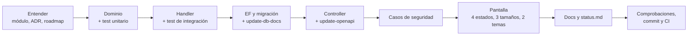

# Flujo de trabajo

Cómo se lleva un cambio desde la idea hasta producción: planificación, porción vertical, comprobaciones, git, revisión y cierre. Las recetas concretas de cada capa están en [backend/recipes.md](../backend/recipes.md) y [frontend/recipes.md](../frontend/recipes.md).

## Visión general



Se trabaja por **porciones verticales**: una funcionalidad atraviesa todas las capas y queda usable antes de empezar la siguiente ([roadmap/implementation-order.md](../roadmap/implementation-order.md)). Nada de «primero todo el backend, luego todo el frontend».

## 1. Antes de escribir código

1. **Entiende el módulo**: su documento en [modules/](../modules/), y según lo que toques, [backend/ledger.md](../backend/ledger.md) (dinero), [backend/security.md](../backend/security.md) (permisos) y [backend/api-conventions.md](../backend/api-conventions.md) (API).
2. **¿Cambia una decisión de arquitectura o añade algo de la lista prohibida** (MediatR, Redis, NgRx…)? Escribe antes un ADR en [adr/](../adr/README.md) y acuérdalo.
3. **¿Es una fase del roadmap?** Márcala «en curso» en [roadmap/status.md](../roadmap/status.md).
4. **¿Hay decisiones de producto abiertas?** Mira [product/open-questions.md](../product/open-questions.md); no inventes reglas de negocio, pregunta.

## 2. La porción vertical

| # | Paso | Dónde | Comprobación |
|---|---|---|---|
| 1 | **Dominio**: entidad o método con sus invariantes; devuelve `Result` | `finanzas-hub-api/src/Modules/X/.../Domain` | Test unitario |
| 2 | **Caso de uso**: comando o consulta + handler `internal` | `Modules/X/.../Application` | Test de integración contra PostgreSQL |
| 3 | **Persistencia**: `DbSet` en `IXDb`, mapeo y migración | `IXDb`, `Infrastructure/Persistence/Configurations/X`, `tools/add-migration.ps1` | Migración en limpio y sobre la base anterior; `node tools/update-db-docs.mjs` |
| 4 | **Endpoint**: acción en el controller del recurso | `Api/Controllers/X` | `tools/update-openapi.ps1` |
| 5 | **Seguridad**: 404 para lo ajeno, roles, participación | Tests de integración | Matriz de [backend/security.md](../backend/security.md) |
| 6 | **Frontend**: tipos, servicio y pantalla | `finanzas-hub-web/src/app/features/<sección>` | `npm run api:generate`; spec; cuatro estados, tres tamaños, dos temas |
| 7 | **Docs**: módulo, ADR si aplica, `status.md` | `docs/` | Enlaces que funcionan |

Detalle con código: [backend/recipes.md](../backend/recipes.md), [frontend/recipes.md](../frontend/recipes.md).

## 3. Comprobaciones antes de confirmar

```powershell
# finanzas-hub-api
dotnet build PersonalFinance.slnx          # avisos = errores
dotnet test PersonalFinance.slnx           # unitarios, integración y arquitectura
tools/update-openapi.ps1                   # si cambió la API (con la API en marcha)
node tools/update-db-docs.mjs              # si hubo migración

# finanzas-hub-web
npm run api:generate                       # si cambió el contrato
npm run lint
npm test -- --watch=false
npm run build
npm run e2e                                # si tocaste un recorrido crítico (API y Worker en marcha)
```

Después, las listas de comprobación de [backend/common-bugs.md](../backend/common-bugs.md#lista-de-comprobación-antes-de-un-pull-request) y [frontend/common-bugs.md](../frontend/common-bugs.md#lista-de-comprobación-antes-de-un-pull-request), y la [Definition of Done](definition-of-done.md).

## 4. Git

**Dos repositorios.** El principal (`PersonalHubV2`, remoto `finanzas-hub-api`) contiene el backend, la documentación y `AGENTS.md`; `finanzas-hub-web/` es un repositorio aparte, anidado. Un cambio de punta a punta son dos commits, uno en cada uno.

**Cómo se trabaja hoy**, con una sola persona: directamente sobre `main`, un commit por fase en cada repositorio, titulado `Fase N - Qué hay ahora` y con la lista de lo que la persona usuaria puede hacer tras el cambio.

**Con más personas en el equipo:**

- Una rama por cambio desde `main`: `feature/<módulo>-<algo>`, `fix/<algo>`, `docs/<algo>`.
- Commits pequeños con mensaje en español que diga qué cambia para quien usa la aplicación, no qué archivos se tocaron.
- Pull request hacia `main` con la plantilla de abajo; el CI de Jenkins compila y prueba la rama.
- Se fusiona cuando el CI está en verde y alguien lo revisó.
- Si el cambio toca los dos repositorios, enlaza un pull request con el otro y fusiona primero el backend.

**Nunca** subas `.env`, secretos, `appsettings.*.json` con credenciales, `bin/`, `obj/`, `node_modules/` ni `dist/`. Un secreto que llegó a git se **rota** ([devops/secrets.md](../devops/secrets.md)).

## 5. Pull request

Plantilla:

```markdown
## Qué cambia
Lo que la persona usuaria puede hacer ahora (o el problema que deja de pasar).

## Cómo se hizo
Módulos y capas tocados; decisiones no obvias; ADR si lo hay.

## Cómo probarlo
Pasos para verlo en local y tests que lo cubren.

## Comprobaciones
- [ ] dotnet build / dotnet test (incluida integración)
- [ ] npm run lint / npm test / npm run build
- [ ] Contrato OpenAPI y tipos regenerados (si aplica)
- [ ] Migración revisada y update-db-docs (si aplica)
- [ ] Caso de seguridad: lo ajeno responde 404
- [ ] Cuatro estados, tres tamaños, dos temas (si hay pantalla)
- [ ] Docs y roadmap/status.md actualizados
```

Qué mira quien revisa, por orden: corrección financiera, privacidad y autorización, fronteras entre módulos, integridad y auditoría, idempotencia, y después legibilidad y tests. Es el mismo orden de prioridades de [AGENTS.md](../../AGENTS.md).

## 6. Después de fusionar

1. El CI despliega a **dev** solo. Compruébalo ([devops/deployment.md §8](../devops/deployment.md#8-comprobar-un-despliegue)).
2. Aprueba la promoción a **prod** en Jenkins cuando dev esté bien.
3. Si cierra una fase, actualiza [roadmap/status.md](../roadmap/status.md) con su estado y lo que dejó pendiente, y la línea de «Estado» de [AGENTS.md](../../AGENTS.md).

## 7. Cuando algo sale mal

- **Un test de arquitectura falla**: corrige el código, no el test.
- **El CI falla y en local no**: probablemente un test de integración o una diferencia de entorno ([devops/common-issues.md](../devops/common-issues.md)).
- **Prod se rompe tras desplegar**: vuelve a la etiqueta anterior y sigue [devops/operations.md § Ante un incidente](../devops/operations.md#ante-un-incidente).
